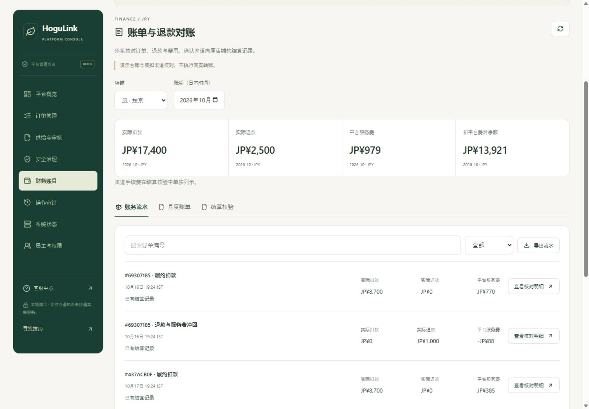

# 第二十轮：账单、退款对账与结算核验

日期：2026-10-18。适用店铺端和平台端，三语言 PC/H5。本轮在本地演示支付上补齐账务闭环；没有接入真实 PSP、银行转账或正式税务发票。

## 依据与同行参考

产品依据为根目录 PRD V1.4 的 49.1、49.5 和第 50 章：店铺为收款主体，PSP 直接结算服务款，平台服务费独立追溯，退款同步冲回相应平台费。平台不持有服务款、不做二次转账，技师没有独立提现钱包。

- [Stripe 结算对账说明](https://docs.stripe.com/reports/payout-reconciliation)：参考逐笔交易与结算批次关联、收入/退款/手续费拆分、失败与未结算项目分开核对的思路。
- [Stripe Connect direct charges](https://docs.stripe.com/connect/direct-charges)：用于核对商户收款与平台费用的账户边界，当前没有实现真实 Stripe 集成。
- [くらしのマーケット店铺费用与账单](https://faq.curama.jp/docs/shop/fees-and-invoicing/)：参考费用明细可追溯的组织方式。其退款后的预约费用规则与本项目不同；本项目继续按 PRD 和原订单冻结规则冲回平台费。

## 本轮完成的流程

1. 顾客支付保障与正式扣款分开，单纯授权、取消授权不会产生收入流水。
2. 技师完成服务后，实际演示扣款、原费率的平台费和现金流水在同一事务保存。取消费/爽约费按原订单政策入账，平台服务费为零。
3. 原店铺处理顾客售后退款时，新增独立退款行，关联原扣款，并同步保存实际退款额与平台费冲回。多次部分退款按累计应冲回额计算差额，完整退款最终冲尽原平台费。
4. 店铺或平台按日本时间选择月份、检查明细、生成不可改写的账单版本并导出 CSV。账单生成后有新退款时提示更新，生成新版本保留旧账单。
5. 平台财务逐笔记录演示渠道回单。扣款、退款、平台费分别核对，净额与渠道手续费再做算术检查；差异不能手工强制通过。
6. 所有跨期未核验流水均匹配、无售后/账务阻断且净额非负时，平台生成核验单，原店铺确认后才能记录演示渠道结算结果。
7. 店铺可提出异议；平台答复后必须重新由店铺确认。失败重试同样重新确认，已完成的记录保持不变。
8. 核验完成后再次退款，新增负数待核验调整，留到后续正向收入抵扣；不会修改原账单或原结算结果。

这里的“结算核验”记录渠道结果，不触发资金移动。“售后待核验”是本系统的核验限制，不声称冻结 PSP 或银行资金。

## 账务数据与边界

### 流水和月账单

`MoneyEntry` 区分 `CAPTURE`、`CANCELLATION`、`REFUND` 与历史余额 `OPENING`。金额为整数日元；`platformFee` 在退款行中为负，净额为 `captured - refunded - platformFee`。订单、支付事实、费用台账与流水在同一事务落库。财务核验还会比对订单累计扣款/退款及费用台账，失配时阻断核验。

月份使用 JST，按流水发生时间分组；退款进入实际退款月份。月账单快照保存原始行，不随之后退款变化。相同内容复用原版本，新交易产生新版本。月账单是演示业务对账单，包含渠道手续费前的净额，不是税务发票，也不表示银行已到账。

旧订单没有逐笔流水时，只将已知扣款、累计退款和费用余额导入一次 `OPENING`，时间为导入时间，明确标记 `LEGACY` 并显示提示。不会伪造历史扣款/退款时间；该余额不能作为导入月新增服务收入。旧订单先退款时，先导入原余额，再新增本次退款行，防止重复计算。

### 渠道核对

- 财务录入扣款、退款、平台费、渠道手续费、净额及回单编号，保留每次更正历史。
- 扣款与退款非负；平台费、渠道手续费及净额可为负。渠道退回手续费时可记录负数费用，不预设真实 PSP 是否退费。
- 三个交易分量必须与账面逐项相同，且 `net = captured - refunded - platformFee - processorFee`，才为 `MATCHED`，否则保持 `DIFFERENCE`。
- 回单编号在同店不能分配给另一流水；更正需要当前版本。已记入完成核验单的流水不能再修改回单。
- 手续费与平台费冲回独立展示，不把平台费冲回充当渠道退费。

### 结算核验状态

| 当前状态                   | 操作方与动作               | 结果                     |
| -------------------------- | -------------------------- | ------------------------ |
| 无活动核验单               | 平台生成                   | `DRAFT`，等待原店铺      |
| `DRAFT`                    | 原店铺确认                 | `SHOP_CONFIRMED`         |
| `DRAFT` / `SHOP_CONFIRMED` | 原店铺提出异议             | `DISPUTED`               |
| `DISPUTED`                 | 平台答复                   | `DRAFT`，重新等待确认    |
| `SHOP_CONFIRMED`           | 平台记录失败               | `FAILED`                 |
| `FAILED`                   | 平台重试                   | `DRAFT`，重新等待确认    |
| `SHOP_CONFIRMED`           | 平台记录渠道结果与唯一编号 | `RECORDED`，最终不可改写 |
| 任一非最终状态             | 平台作废                   | `VOID`，释放核验占用     |

每店最多一份活动核验单，包含所有尚未完成核验的跨期流水。负净额不能单独记录结算，保留待后续正向收入抵扣；净额为零时允许记录对平结果，不表示发生转账。

确认、失败及记录结果时再次核对流水集合、回单版本、售后状态和账务一致性。已选订单出现新退款、任何新负数调整、原回单更正或新售后都会使原单失效，要求作废后重新生成。无关新正向收入可进入下一单。

## 售后、权限和隐私

待处理退款、任一未结束的关联售后（含私有工单）会阻断核验。财务只获得“售后待核验”标志，不返回工单内容、编号、地址或顾客标识。财务确认不会替平台调查结案，平台处理建议也不自动产生退款，仍由原店铺按现有退款流程执行。

新增 `finance.write`：OWNER、FINANCE 可记录渠道回单、生成平台账单及核验单、答复/失败/重试/记录结果/作废。AUDITOR 仅财务读取；OPS、SUPPORT 不因工单权限获得财务写权限。每次请求重新检查员工当前资格，停用或撤权后的旧会话无法继续操作。

店铺仅访问自己的账务，可生成本店账单、查看回单、确认或提出异议，不能修改平台渠道核对数据，也不能确认别店核验单。停止公开展示不妨碍合法历史账务处理。顾客与技师不获得财务工作台权限。

所有新增写请求要求 `Idempotency-Key`，与操作者、动作及输入绑定；相同键不同内容返回冲突。回单更正和核验动作检查版本，账单和生成核验单检查当前流水令牌。重试返回原操作的不可变结果，不返回后来更新后的对象。审计和本地通知仅保存必要引用，不复制备注、地址或银行资料。

## 页面与样式

- [店铺财务](http://127.0.0.1:3000/zh-cn/merchant?tab=finance)：本月四项指标、交易明细、版本账单、结算核验、异议与共享处理记录；保留原有商户方案入口。
- [平台财务](http://127.0.0.1:3000/zh-cn/admin?tab=finance)：店铺/月份筛选、差异和未核对队列、回单历史、账单版本、核验动作和结果编号。
- 原订单可直达相应财务流水，财务流水可返回原订单，售后实际退款自动出现在账务侧。
- 延续深绿、暖白、黄铜色层次，PC 四列指标与清晰表格，手机转换为卡片及底部操作面板；新输入在手机不小于 16px，主要触控操作保持 44–48px。
- 日/英/中标签、错误与确认信息一致；每 15 秒及回到页面时刷新。打开确认面板后冻结当时版本和目标，后台变化不会偷偷替换确认金额。
- CSV 只导出账务必要字段并防公式注入，不包含顾客地址、顾客 ID、支付路由或私有售后资料。

[店铺手机结算效果](screenshots/merchant-settlement-mobile.jpg)

## 接口

均位于 `/v1`；读接口仅返回授权范围。具体共享类型见 `packages/contracts/src/finance.ts`。

| 方法与路径                                             | 输入 / 行为                                                                    |
| ------------------------------------------------------ | ------------------------------------------------------------------------------ |
| `GET /merchant/billing`                                | `month=YYYY-MM`，可选本店 `storeId`                                            |
| `GET /admin/finance`                                   | 可选 `storeId`、`month`；默认优先有扣款的店铺                                  |
| `POST /admin/finance/:storeId/entries/:entryId/report` | `version, reference, captured, refunded, platformFee, processorFee, net, note` |
| `POST /admin/finance/:storeId/statements`              | `month, token`                                                                 |
| `POST /merchant/billing/:storeId/statements`           | 本店 `month, token`                                                            |
| `POST /admin/finance/:storeId/settlements`             | `token, note`，生成核验单                                                      |
| `POST /finance/settlements/:batchId/actions`           | `version, action, note`；`RECORD` 还要求 `reference`                           |

备注 10–1500 字符；回单/结果编号 6–100 个英数、下划线或连字符且以英数开头；重试键 8–160 字符。`rows` 为所选月流水，`openRows` 为该店所有月份未完成核验流水，账单按月份读取，核验历史按店铺读取。

使用现有事务型 records 存储：`moneyEntries`、`moneyReports`、`moneyReportHistory`、`providerReferences`、`billStatements`、`settlementBatches`、`settlementHistory`、`financeResults`、`financeIdempotency`。当前没有引入独立 SQL 账务表；生产迁移需补索引、约束及留存策略。

## 验收

| 验证               | 结果                                                               |
| ------------------ | ------------------------------------------------------------------ |
| API 测试           | 434 项通过，其中本轮新增 28 项财务领域测试                         |
| 前端规则/会话测试  | 53 项通过，总计 487 项                                             |
| 隔离 HTTP/SSR      | 1076 项通过，其中新增财务 86 项                                    |
| 浏览器实际流程     | 22 项业务断言通过                                                  |
| 三语言、多尺寸布局 | 132 组不同组合通过，320/390/768/1440px，页面/账单/回单弹层及空店铺 |
| 类型与生产构建     | 严格类型和生产构建通过                                             |

新增领域测试 `hogulink-api/test/finance.test.ts` 覆盖授权/扣款边界、多次退款舍入、取消费、账单不可变、JST 跨月、回单差异/更正/重复引用、渠道负数手续费、售后阻断、全部核验状态、陈旧确认、结算后退款抵扣、重试与权限撤销、旧余额导入和账务漂移。

`scripts/smoke-finance.mjs` 已纳入 `npm run smoke:isolated`。本轮测试使用独立内存 API，浏览器使用 `localhost:3001` 与独立 API；没有向主预览 SQLite 写入测试订单，没有替换主预览登录。

浏览器完整演练：两笔履约扣款共 ¥17,400 → 两次售后退款共 ¥2,000 → 更正渠道差异 → 账单版本保留 → 平台生成 → 店铺异议 → 平台答复 → 店铺确认 → 失败 → 重试 → 再确认 → 记录 ¥14,377 核验结果 → 再退 ¥500 → 新增 -¥456 待抵扣调整，原结果保持 ¥14,377。新账单显示累计退款 ¥2,500、净平台费 ¥979、渠道手续费前净额 ¥13,921。

本机运行证据保存在 `.qa/finance/check-final.log`、`build-final.log`、`smoke-final.log`、`browser-results.json`。截图为隔离演示数据。

## 后续生产接入

真实 PSP 事件摄取、签名与重放保护、乱序/重复事件、异步退款与补偿、日对账任务、渠道资金可用状态、银行到账核验、真实结算失败原因及通知仍待接入。人工录入演示回单不能替代这些能力。

正式税务发票、年度方案账单/续费/逾期、财务双人审批、生产数据分页与归档、PostgreSQL 并发/恢复和真机验收仍按开发计划推进；当前月账单不代表这些项目完成。
