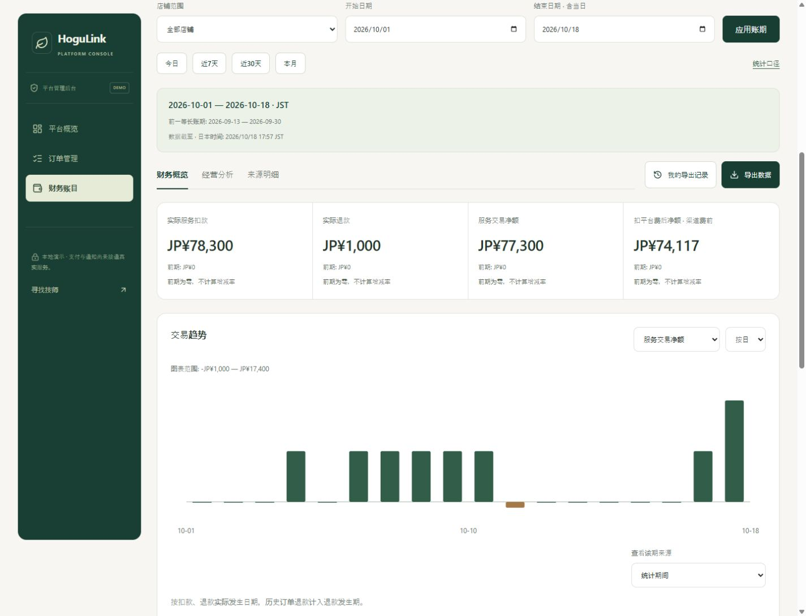
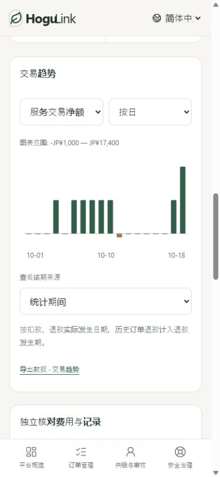

# 第二十三轮：财务报表、经营分析与数据导出

日期：2026-10-18。基于订单、独立资金流水、退款冲回、结算核验、年费账单和发票记录生成报表，覆盖日、英、简中 PC/H5。所有数字为本地演示数据，报表不代表银行到账、纳税申报或扣除全部成本后的利润。

## 依据与同行参考

对照 PRD V1.4 的 M11/M12、A05、US-M03、经营报表及49.5：服务交易、平台费、年度方案费用应分开；订单统计按店铺隔离，权限和审计延续已有约束。

- [Square 销售汇总与趋势](https://squareup.com/help/us/en/article/5381-in-app-summaries-and-reports)：参考日期范围、前期比较、店铺范围、指标切换和分项明细的组织方式。
- [Square 报表导出](https://squareup.com/help/us/en/article/8362-print-export-or-email-your-reports)：参考按报表范围导出 CSV 供后续核对；本项目没有邮件发送。
- [Stripe 余额汇总](https://docs.stripe.com/reports/balance)：参考交易分类、费用/净额拆分及汇总与逐笔明细的区别。
- [Stripe 出款对账](https://docs.stripe.com/reports/payout-reconciliation)：参考交易发生期与结算结果期应独立核对，结算结果可以关联更早的交易。

采用指标设计技能梳理定义，以现有服务端记录为本项目的数据来源。未借同行展示数字设定目标、增长率或收入预测，也没有接入 Square、Stripe 或外部数仓。平台款项发生额不等同于会计收入确认。

## 入口与完整流程

- [店铺：财务与计费 → 财务报表与经营分析](http://127.0.0.1:3000/zh-cn/merchant?tab=finance&section=reports)，只能本店。
- [平台：财务账目 → 财务报表与经营分析](http://127.0.0.1:3000/zh-cn/admin?tab=finance&section=reports)，默认全部店铺，可选择单店；经营分析提供店铺对比和继续查看该店铺。

选择今日/近7天/近30天/本月，或设置自定义账期 → 查看财务概览和前一等长账期 → 切换按日/按月趋势与指标 → 查看某期来源 → 进入原订单、流水核对、指定结算批次、年费记录或指定发票 → 回到原报表继续查看。报表日期保留在当前工作台，跨店切换不会保留上一店的明细。

经营分析提供下单批次的完成、取消和未结束状态、服务项目及预约方式分组；平台另有店铺经营对比。五类来源明细分页显示，文件导出包含该账期、该范围的全部分页数据。

## 统计口径

全程使用日元、`Asia/Tokyo`。日期包含首尾两天，服务端按日本时间午夜的左闭右开区间查询；允许1—366天，不接受未来结束日期、无效日期或未知筛选字段。比较期为紧邻之前、同等天数的区间。前期为零时不生成增长百分比，负数前期使用其绝对值作为比较分母。

| 指标域           | 口径和限制                                                                                                                             |
| ---------------- | -------------------------------------------------------------------------------------------------------------------------------------- |
| 实际扣款、退款   | 独立资金流水的实际发生日期；不使用预授权、报价或下单金额作为收入。历史订单跨月退款计入退款发生期，可能出现负数交易净额。               |
| 服务交易净额     | 本期实际扣款 − 本期实际退款。                                                                                                          |
| 平台服务费       | 使用原交易冻结的费用与实际冲回之和，不按当前方案费率重算历史。                                                                         |
| 扣平台费后净额   | 实际扣款 − 实际退款 − 平台费（含冲回）；尚未扣渠道费及其他经营成本。                                                                   |
| 渠道费           | 只采用核对一致的渠道记录。任何相关记录未核对或存在差异时，全量扣渠道费后净额为未知，不填零。                                           |
| 每笔扣款均额     | 本期扣款金额 / 本期实际发生扣款的去重订单数，包含发生扣款的取消费用；无扣款订单时为空。                                                |
| 新建订单与完成率 | 按下单时间选取，查看当前状态。完成率＝已完成 / 已结束（完成、取消、拒绝、超时）；未结束不计分母。没有已结束订单时不造0%或100%。        |
| 订单明细金额     | 单笔订单全生命周期的累计扣款/退款参考值，与本期资金发生额区别展示。历史报表订单状态是查询时当前状态，不冒充历史时点结账快照。          |
| 结算核验         | 已记录批次按结果记录时间统计，其余按创建时间筛选。记录金额不累加到交易净额，也不声称银行到账；明细可进入对应批次。                     |
| 年费             | 已付款按付款时间统计，待付/作废按创建时间筛选。税额尚未核定，独立于顾客服务款；不改变订单交易额。                                      |
| 开票             | 按开具时间筛选；记录包含更正版本，金额只累计首次开具版本。原发票减首次退款调整得到开票费用净额，不再加到交易发生额。                   |
| 当前余额         | 待付/逾期年费、尚未核验服务款和处理中批次是查询时当前快照，独立于所选历史账期，明确显示数据截至时间。                                  |
| 导入旧余额       | 单独显示笔数和净额，不补造历史交易日期、不混入实际发生趋势。                                                                           |
| 核对覆盖         | 按本期明细笔数统计一致、差异、未核对和业务待核验；业务待核验可与核对分类交叉，不应相加当作总笔数。私有工单仅影响最小状态，不展示正文。 |

店铺对比按相同范围与定义汇总，服务交易额可与平台总额核对。当前商户账号仍为单店隔离，平台全部店铺视图不等同于商户多门店账号体系。

## 导出、权限与追溯

导出支持财务汇总、趋势、服务流水、订单、结算、年费、发票和店铺对比共8类。打开确认页会冻结当时的来源令牌，明确显示范围、账期、分项与总行数；来源变化时返回 `REPORT_CHANGED`，刷新后须重新核对。CSV 导出不修改订单、退款、结算、订阅或发票记录。

- 服务端保存不可变的结构化导出快照、操作者、店铺范围、生成时间、分项和行数，当前工作台显示最近10条本人的范围内导出。历史下载不重新计算旧数据；CSV 表头按当前语言生成。
- 每个文件带导出编号、日本时间、账期/比较期、币种、时区、粒度、店铺引用、DEMO标记、来源令牌与 `reporting-demo-v1` 口径版本。
- 财务汇总包含23项指标、8项当前余额、5项核对指标，注明统计基准与单位。当前快照不伪造前期值。`BASIS_POINTS` 用于完成率（10000＝100%）；店铺比较的对应表头也注明 bps。空值 `UNASSESSED` 表示未核定或未提供，不等于零。
- 所有分页都包含在导出范围内；明细超过5000条拒绝导出并要求缩小范围，不静默截断。单次工作区设置20000条来源规模保护，当前版本尚非生产数仓或异步大文件系统。
- 写入绑定8—160字符重试键，相同请求重试只生成一次快照和审计事件；成功后新一次确认导出使用新键，产生独立记录。下载仍检查当前账号、权限与店铺访问。
- 平台读取要求当前 `finance.read`；新增 `finance.export` 仅 OWNER、FINANCE 具备。AUDITOR 可读，不可新导出或下载；权限撤销后旧会话不能取回文件。本店商户保留本店导出权限，暂停新单或欠费不会封住存量财务记录。
- 原始报表和文件均排除顾客标识、姓名/上门地址、房间、付款路由、发票抬头邮箱/税号、私有工单正文与自由文本。必要订单、账单和票据引用用于核对。CSV 防公式文本注入，同时保留负数金额的数值类型，避免退款冲回变成不可汇总文本。

## 接口

全部以 `/v1` 为前缀，沿用当前会话与来源校验：

| 接口                                | 行为                                                         |
| ----------------------------------- | ------------------------------------------------------------ |
| `GET /merchant/reports`             | 本店报表，from/to必填，groupBy为day/month，可选本店storeId。 |
| `GET /admin/reports`                | 相同口径，可省略storeId查看全部；按当前财务读取权限校验。    |
| `POST /merchant/reports/export`     | 本店导出，正文 `{query,token,type}`，携带Idempotency-Key。   |
| `POST /admin/reports/export`        | 平台导出，需finance.export；不能用前端覆盖金额或列集合。     |
| `GET /merchant/reports/exports/:id` | 当前店铺账号下载自己的固定快照。                             |
| `GET /admin/reports/exports/:id`    | 当前平台操作者下载自己的固定快照，重新校验导出权限和范围。   |

工作区返回 current/previous、趋势、经营分组、店铺对比、五类明细、当前余额、核对覆盖及本人导出记录。导出类型为 `summary / trend / money / orders / settlements / annual / invoices / shops`。报表不存在修改资金和税额的接口。快照保存在 `reportExports`，幂等记录在 `reportExportRetries`；审计仅含必要引用，不保存文件正文。

## 验收

- `npm run check`：586项测试（524后端、62前端/会话）、严格类型和生产构建通过。新增28项报表领域测试、5项日期/比较/导出测试。
- `npm run smoke:isolated`：1415项 HTTP/SSR 检查通过，其中本轮117项，覆盖当前会话权限、店铺隔离、真实订单/退款/结算/年费/开票联动、重试、旧快照、范围和三语入口。
- 本地预览开发重载时曾短暂未就绪，已为隔离检查增加有时限的三语首页就绪检查；持续失败仍会报错，原有业务断言未被跳过或放宽。主预览恢复后完成上述全量复测。
- 浏览器246组布局、37项操作/结果断言：三语言及320/390/768/1440宽度，包含财务概览、经营分析、店铺对比、五类明细、统计说明、来源详情、导出确认与历史。最终新页面无运行错误。
- 实际下载并检查汇总、完整分页流水、店铺对比与历史文件；验证来源变化拦截、固定快照、独立导出记录、未知金额、负数数值类型和隐私排除。修复手机图表刻度过小、核对状态翻译、待付年费金额标识和重复确认导出的重试键沿用问题。
- 写测试使用独立内存库及localhost:3001；未向主预览库写测试订单或替换主预览会话。临时服务与标签已关闭，保留主3000/4000服务。
- 原始结果：[完整检查](../.qa/reporting-check.log)、[隔离集成](../.qa/reporting-smoke.log)、[浏览器](../.qa/reporting/browser-report.json)。测试源：[领域](../hogulink-api/test/reporting.test.ts)、[HTTP](../scripts/smoke-reporting.mjs)、[日期与导出](../scripts/reporting-model.test.ts)。

正式财务报表仍需要真实PSP/银行数据、核定税务与会计口径、生产数据覆盖及容量验收。当前不包含损益核算、年度费用权责分摊、客户归因漏斗、技师工时利用率或商户多门店账号；这些所需的数据源和业务定义没有用演示数字补造。
