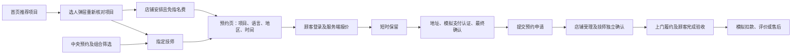

# H5 五入口：业务流程与前后端接口对照

第三十七轮：中央预约目录增加顶部展开筛选与费用明细；公开列表新增 travel=any/free，免费条件先过滤实际项目交通费，再计算当前店铺指名费和总价。搜索、地区、语言、时长、预约方式及排序可以组合，预约入口明确指定当前技师并携带实际项目和可约时间。见 [技师目录业务与接口](H5_THERAPIST_DIRECTORY.md)。

第三十六轮更新：发现页已由直接跳转的静态拼接卡片升级为分页内容流，新增详情、图集、点赞/收藏、本人收藏管理与真实阅读统计。使用 `GET /v1/public/discovery`、`GET /v1/public/discovery/:id` 及本人 `customer/discovery` 接口，详见[发现业务闭环](H5_DISCOVERY_BUSINESS.md)。下文保留此前五入口及首页的实现记录。

更新：2026-10-19。本轮在现有 HoguLink 项目实现，非另起一套静态原型。参考用户提供的东郊到家 H5 首页、发现、预约、消息、我的及六张截图。已确认本轮范围：五个入口与现有业务对接；优惠券仅做接口设计，储值充值继续暂缓。

首页精修补充：三种时长推荐后加入其他合格店铺，最多五项；推荐仍沿用 `serviceChoices` 的公开资格、地区/语言/模式与店铺费用过滤。三语语言弹层保留查询条件并更新文档语言；无匹配时提供真实的指定时间/全部技师恢复入口。本轮没有新增服务端接口或修改下单规则。[首页说明与验收](H5_HOME_REFINEMENT.md)。

## 参考页面与实际实现

| 入口     | HoguLink 路由（前缀 `/:locale`）   | 前端操作                                                                       | 数据/接口                                                                            |
| -------- | ---------------------------------- | ------------------------------------------------------------------------------ | ------------------------------------------------------------------------------------ |
| 首页     | `/`                                | 品牌横幅、四快捷入口、时长分类、安心说明、推荐项目                             | `GET /v1/public/staff-listings`，按当前合格供给组合项目；项目卡进入选人弹层          |
| 发现     | `/discover`                        | 五分类：推荐、同城店铺、预约指南、技师档案、安心服务；手机双列瀑布流及店铺搜索 | 当前公开目录 + 自有三语指南；档案、店铺详情/收藏接原有接口                           |
| 中央预约 | `/therapists`                      | 按技师/店铺搜索，地区、语言、时长、预约方式、总价/最早时段排序，分页           | 新增 `GET /v1/public/h5/therapists` 和 `/v1/public/h5/bootstrap`                     |
| 消息     | `/account/messages`                | 四分类首页：订单服务、活动通知、系统通知、在线客服；订单分类进入真实消息列表   | 订单沿用 `GET /v1/customer/inbox`、`POST /v1/customer/inbox/read`；活动/系统尚未开放 |
| 我的     | `/account`                         | 登录、本人订单分区、当前预约、收藏/足迹/投诉、地址、店铺收藏、设置             | `GET /v1/auth/session`、`GET /v1/customer/overview`；沿用现有本人范围接口            |
| 项目选人 | `/services?duration=60&offering=…` | 首页指定项目直接打开选人弹层；选指定技师或由店铺安排                           | 重新读取公开目录；即时预约逐一复核可约时段；进入现有 `/book/:slug`                   |
| 权益说明 | `/account/benefits`                | 清楚显示优惠券及储值未开放；展示当前服务地区                                   | `/v1/public/h5/bootstrap`；不返回虚构余额、券金额或充值操作                          |
| 设置     | `/account/settings`                | 切换三语、地址、权益、隐私、条款、售后、账号入口、本人退出登录                 | 现有账号及法务说明页；退出沿用 `POST /v1/auth/logout`                                |
| 订单列表 | `/account/bookings`                | 手机状态横栏、搜索/日期筛选、紧凑订单卡；点卡进入独立详情                      | 本人订单及原筛选接口；PC 继续使用表格与选中详情                                      |

底栏统一为“首页 / 发现 / 预约 / 消息 / 我的”，中央预约为凸起圆形按钮。手机地区选择为全屏搜索页，头像可点开照片预览；返回、Escape、焦点与背景滚动由原生对话框管理。顾客 H5 采用参考中的薄荷绿、白卡片、紧凑项目/人员列表；PC 和业务工作台沿用现有布局。横幅、项目图片和六张示例人物照片为原创生成素材，只替换演示模式下的已知种子头像，不覆盖商户上传肖像。26 个已观察到的公共 UI 图片用于图标/背景，来源保存在 `hogulink-web/public/images/h5-ui/sources.json`。没有复用第三方商标、真人肖像、销售数字或用户内容。

本轮进一步使用参考站已有的登录会话观察发现瀑布流、消息分类/空列表、个人中心、设置、订单空状态及地区选择。北京列表可以展示，但点击“去下单”仍提示“请选择就近商户下单”；用户随后确认本轮先完成当前可见页面。没有猜测参考站私有接口、绕过定位限制或提交真实订单。HoguLink 发现内容使用自有档案和预约指南，不假冒原站的公益、用户帖子或健康课堂。详细可观察流程及对应入口见 [H5_REFERENCE_FLOWS.md](H5_REFERENCE_FLOWS.md)。

## 两条预约路径



1. 列表的“最早可约”来自当前可约接口，列表不锁定时段。进入预约页继续校验；失败不提供虚构时间。
2. 带入字段限定为地区、服务语言、预约方式、服务项目及已选时间。不带入他人的地址、旧保留、支付标识或订单。
3. 首页项目卡携带 `offering`，服务页先按当前条件确定有效项目，再自动打开同一个选人弹层。供给失效时不会选其他项目冒充原项目。
4. 店铺自定义指名费进入列表总价；指定技师的总价 = 服务费 + 交通费 + 当前店铺指名费。由店铺安排的报价不收指名费。
5. 最终价格、取消政策、自动受理规则以服务端报价/订单快照为准。列表及设置修改不覆盖已成立订单；指定技师的更换仍须顾客明确同意。
6. 服务不足时长不能结束；技师提交结束后仍待顾客验收。付款能力保持现有模拟实现。

## 已实现的新增公共接口

### `GET /v1/public/h5/bootstrap`

无需登录、无写入。服务地区只来自存在公开合格人员的当前店铺。

```ts
{
  version: 1;
  currency: 'JPY';
  demo: boolean;
  serviceAreas: string[];
  features: {
    coupons: false;
    storedValue: false;
    nativeApp: false;
    gpsDistance: false;
  };
}
```

不请求精确定位权限，不编造公里数。手机可手选当前东京服务地区。

### `GET /v1/public/h5/therapists`

| 查询字段   | 有效值 / 默认                    | 用途                                       |
| ---------- | -------------------------------- | ------------------------------------------ |
| `area`     | 当前五个东京地区编号，可省略     | 按店铺上门服务地区筛选                     |
| `language` | `ja / en / zh`，可省略           | 必须匹配技师支持语言                       |
| `mode`     | `SCHEDULED / INSTANT`，默认前者  | 即时模式继续使用店铺授权范围与待机条件     |
| `duration` | `60 / 90 / 120`，默认 60         | 只选该人员可提供的同店合格项目             |
| `search`   | 最多 80 字                       | 三语技师名/店铺名，NFKC 标准化、忽略大小写 |
| `sort`     | `recommended / price / earliest` | 稳定推荐顺序、完整总价、当前最早可约       |
| `limit`    | 1–20，默认 20                    | 有界分页                                   |
| `cursor`   | 最多 400 字；接口返回值          | 携带筛选签名和偏移，筛选变化后必须重置     |

响应为 `{items,total,nextCursor,checkedAt}`。每项为 `{listing,store,offering,nominationFee,total,earliestAt}`；`earliestAt:null` 表示当前无可约时段，只提供查看档案/时段入口。公开店铺字段复用原白名单，不暴露内部授权规则或收款路由。

普通和价格分页只查询当前页至多 20 位人员的时段。`earliest` 要在全部匹配人员中比较当前时段，仍需逐人读取；正式大规模供给上线前应改为批量可约快照并做容量验收。分页为实时结果，价格或供给变化后应刷新，不代表冻结的搜索快照。

错误：未知字段/非法参数/重复数组值返回 422；无效或与筛选不匹配的游标返回 400 `INVALID_CURSOR`；服务读取异常显示错误和重试，不能伪装成成功空列表。

## 已有接口及责任

以下均以 `/v1` 为前缀。所有写入继续执行同源检查、身份范围、版本与必要的幂等校验。

| 接口                                                     | 前端责任                                         | 后端责任                                       |
| -------------------------------------------------------- | ------------------------------------------------ | ---------------------------------------------- |
| `GET auth/session`                                       | 初始化/切换账号时清除旧页面数据                  | 从 HttpOnly 会话确定本人及角色                 |
| `POST auth/customer/register` / `verify-email` / `login` | 独立账号注册、验证、登录与返回原页               | 哈希密码、令牌有效期及单次消费、会话轮换       |
| `POST auth/customer/forgot-password` / `reset-password`  | 统一受理提示、恢复入口                           | 令牌哈希、过期/重发/已用失效、撤销旧会话       |
| `GET public/staff-listings`                              | 组织项目、店铺及档案                             | 公开资格、店铺有效性、授权与展示范围           |
| `GET public/staff-listings/:id/availability`             | 显示最新时段；不声称已经保留                     | 资格、语言、项目、地区、休息、占用和即时授权   |
| `POST quotes`                                            | 提交明确的项目、人员、地区、语言、时段与指名方式 | 计算当前日元费用、取消政策及受理规则快照       |
| `POST booking-holds`                                     | 显示到期和同一保留的恢复入口                     | 短时锁定、身份、限额和占用冲突                 |
| `POST payments/demo-authorizations`                      | 明示模拟支付认证                                 | 现有演示授权逻辑；没有接入真实收款             |
| `POST bookings`                                          | 最终核对后提交，沿用幂等标识                     | 重新验证本人报价、有效保留、授权与重复提交     |
| `GET bookings` / `bookings/:id`                          | 当前预约、原订单及闭环售后                       | 本人/本店/获派技师范围与地址隐私               |
| `GET customer/overview`                                  | 将真实计数与原记录入口对应                       | 查询本人完整历史；最近三笔仅用于展示           |
| `GET customer/inbox`                                     | 过滤、稳定分页、显示摘要与读取状态               | 仅本人订单及本人发起工单，不混入内部安全报告   |
| `POST customer/inbox/read`                               | 只回传已展示过的 `{id,token}`                    | 确认看到的版本，不能吞掉同时到达的新回复       |
| `GET/PUT customer/favorites/:listingId`                  | 技师收藏状态及版本冲突提示                       | 本人收藏、公开资格与版本核对                   |
| `GET/PUT customer/store-favorites/:storeId`              | 店铺收藏与失效可移除状态                         | 同上；不泄露店铺内部字段                       |
| `GET customer/addresses` 等地址接口                      | 保存/选择本人地址，继续在预约确认酒店权限        | 归属、版本及加密保存；不储存房间号和单次许可   |
| `POST customer/support-tickets` 等售后接口               | 从原订单或明确问题进入                           | 原店铺处理普通服务问题；敏感安全问题仅平台可见 |

“我的”计数：`checkout` 为本人未转成订单的有效保留；`active` 为进行中预约；`review` 为当前可评价事项；新增 `closed` 为 `CANCELLED / REJECTED / EXPIRED`，不是仅“取消”，前端相应标为“已关闭”。`support` 和 `favorites` 继续保留原含义。未登录不显示虚构数字。

消息首页四项与参考对应：订单服务进入 `?channel=orders&filter=bookings`，读取真实本人订单消息；活动通知 `?channel=activity` 和系统通知 `?channel=system` 明确显示尚未开放；在线客服进入原售后工单。浮动“查看全部更新”进入 `?channel=orders&filter=all`，不会自动标为已读。旧 `filter=all/unread/bookings/support` 深链接仍进入原真实列表。没有用订单消息冒充活动/公告，没有实现实时客服聊天。底栏显示全局真实未读数，分类不展示无法准确归属的计数。站内消息、邮件服务商受理和用户实际收到是不同状态，不显示未经验证的“已送达”。

足迹保留现有设备存储方案：仅公开档案编号和访问时间，最多 12 条/30 天；读取目录后过滤失效档案，不保存地址、账号或支付信息。

## 优惠券接口设计（未实现，不可调用）

下表是下一阶段的拟议契约。本轮没有这些服务端路由、发券、领取记录或订单抵扣；`features.coupons=false`。当前界面仅提供“暂未开放”说明，不展示伪造的 40/30/20/10 元券或新人已到账弹窗。

| 拟议接口                                | 输入/输出                                                        | 规则                                                                     |
| --------------------------------------- | ---------------------------------------------------------------- | ------------------------------------------------------------------------ |
| `GET public/coupon-campaigns`           | 三语标题、日元金额、门槛、店铺/项目范围、活动起止、规则版本      | 仅返回有效、已审核活动；不返回库存内情或他人领取信息                     |
| `POST customer/coupon-claims`           | `{campaignId,version}` + `Idempotency-Key` → 本人券编号          | 验证顾客、限领次数、活动库存；数据库原子扣库存，重复请求返回同一领取结果 |
| `GET customer/coupons?status=available` | 本人 `AVAILABLE / RESERVED / USED / EXPIRED / VOIDED` 列表及游标 | 按本人隔离，不由前端推定余额或过期状态                                   |
| `POST quotes` 扩展                      | 可选 `couponId` → `subtotal,discount,total,couponSnapshot`       | 服务端核验日元门槛、店铺/项目/时间范围、不叠加；金额不为负               |
| 现有保留/下单事务扩展                   | `AVAILABLE → RESERVED → USED`                                    | 建立有效保留才占券；超时、释放、授权失败原子释放；并发不能两单共用       |
| 退款/取消事务扩展                       | 按不可变优惠快照分摊可退金额                                     | 只退实际实付，券返还政策需先定稿；幂等恢复且不超发                       |

正式开发前仍需确定发券承担方、适用费用、优惠上限、退款返券规则和预算。本轮不替用户决定这些资金规则。储值/充值不在本轮设计与实施范围。

## 验证

新增后端规则测试覆盖能力开关、合格服务地区、三语组合筛选、真实价格/报价一致、分页/非法游标、隐私字段和本人关闭计数；`npm run smoke:h5` 检查公共接口、身份权限与 42 个三语页面。完整检查执行 `npm test`、`npm run test:desktop`、`npm run build`、`npm run smoke:isolated`。615 项后端与 74 项前端测试、1,623 项隔离 HTTP/SSR 检查（含 H5 109 项）、类型检查及生产构建通过。浏览器完成 132 组三语页面布局、12 组地区/照片弹层和 6 组选人弹层检查，最终修复后又针对个人中心/消息做 12 组复查。

浏览器实测实际页面、组合筛选、选人弹层、预约条件带入、个人中心、消息分类、订单筛选及设置；读取主预览已有的独立 localhost 示例会话。写入业务回归使用可丢弃内存 API，没有向主预览创建测试订单。

最新证据与最终结果见根目录 `design-qa.md` 及 `.qa/h5-faithful/`；第一轮证据保留在 `.qa/h5-reference/`。生产上线、真实支付、外部通知、实体设备及大规模最早时段排序仍不在本轮已验证范围内。
