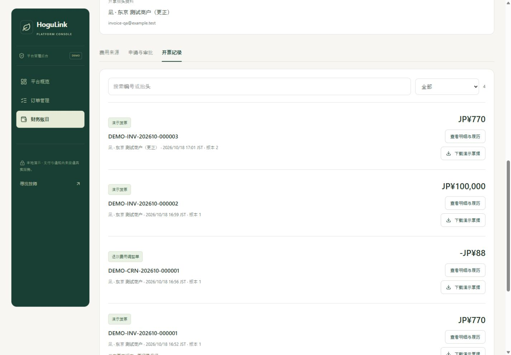
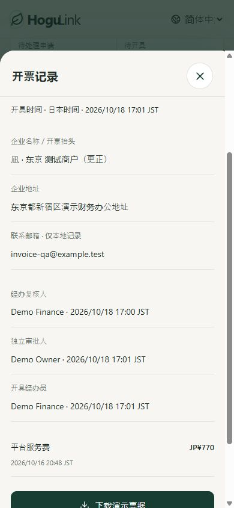

# 第二十二轮：开票申请、记录与财务审批

日期：2026-10-18。店铺与平台共用日、英、简中响应式发票中心，接入月账单、退款平台费冲回和已付款年费。当前为本地演示；开票不移动资金、不发送邮件，也不改变订阅权益。

## 产品依据与同行参考

对照 PRD V1.4 的 M11、A05、8.3、33.4、49.5、第50章：顾客服务款、平台服务费和商户年费分别记录。此处只处理平台服务费和已付款年费，不能以商户服务收入或银行到账金额替代可开票金额。

- [Stripe 发票流程](https://docs.stripe.com/invoicing/overview)：参考申请资料、定稿和发出后的记录分离。
- [Stripe 贷项调整](https://docs.stripe.com/invoicing/dashboard/credit-notes)：参考调整单关联原票据、保留历史的做法；本项目没有接入 Stripe 或创建真实贷项余额。
- [Square 日本开票流程](https://squareup.com/help/jp/ja/article/8387-create-and-send-invoices)：参考 PC/手机上的资料核对、开具及记录管理。
- [日本国税厅适格请求书要求](https://www.nta.go.jp/taxes/shiraberu/taxanswer/shohi/6625.htm)：正式适格发票需满足发行方资格和法定内容。本地尚未核定开票主体、登记号、税额与税目，因此所有文件明确标记 DEMO，`taxAmount`、`registrationNumber` 为 null，不伪造正式税务凭证。

双人复核、失败重试与重审规则是本项目的控制设计，不能解读为上述服务商的统一审批政策。税率与合同口径不在演示中假定。

## 使用入口

- [店铺：财务与计费 → 发票与财务审批](http://127.0.0.1:3000/zh-cn/merchant?tab=finance&section=invoices)。维护本店抬头，从费用来源申请；月账单和已付年费明细都可进入对应来源。
- [平台：财务账目 → 发票与财务审批](http://127.0.0.1:3000/zh-cn/admin?tab=finance&section=invoices&storeId=store-nagi)。选择店铺，查看费用、审批申请和开票记录。
- 演示中，身份面板的“进入演示财务经办工作台”使用独立 `Demo Finance / FINANCE`；“进入演示管理后台”使用 `Demo Owner / OWNER`。两个按钮只服务本地演示。实际员工沿用已有登录、角色和会话撤销机制。
- 先由店铺提交，财务经办复核，切换到另一名有 `finance.approve` 的人员审批，再由审批人以外的财务经办开具。

## 业务闭环

| 来源或阶段       | 最终规则                                                                                                                                         |
| ---------------- | ------------------------------------------------------------------------------------------------------------------------------------------------ |
| 月度平台费       | 日本时间归月；需最新月账单与当前流水一致，来源为实际演示流水且已渠道核对、无未结业务阻断。仅取平台费，排除服务款、渠道手续费与未经核实的旧余额。 |
| 已付款年费       | 使用已付款账单的冻结金额、付款时间和来源；待付、失败、作废不可申请。开票不延长年限、不重复扣费、不冲抵服务款。                                   |
| 试用或全额退款   | 零平台费不造发票；未开票前同月退款按未开票费用净额申请，无正数费用时不能开正向票据。                                                             |
| 提交申请         | 本店抬头版本和费用令牌一起确认，冻结受票方及来源明细。平台不能替商户改抬头或发起普通费用申请。                                                   |
| 经办复核         | `finance.write`、当前权限、版本、来源状态和四项明确核对均有效后，才进入独立审批。可展开明细核对订单、时间和费用分项。                            |
| 独立审批         | 需要 `finance.approve`，且审批人与复核人不同。目前仅 OWNER 具有，FINANCE 不能审批。                                                              |
| 开具             | 审批人以外的财务执行；复核和审批人员仍须有效且有相应权限。权限失效显示原因，需重新申请和审批。                                                   |
| 失败与重试       | 失败保留批准状态和尝试履历，不创建票据。成功生成服务端唯一编号；相同重试键不重复创建文档或事件。                                                 |
| 退回、驳回、撤回 | 财务可退回补充或驳回；店铺可撤回未完成申请。退回后以最新资料再申请，复核与批准清空；驳回和撤回释放费用占用。                                     |
| 待开票期间退款   | 退款照常办理。新增流水、对账更正或关联票据更正会使旧来源令牌失效，不能沿用旧审批。跨月退款同样使待开票的原费用需要重审。                         |
| 已开票后退款     | 原记录不改；依据实际平台费冲回生成待调整来源，核对后由店铺或平台申请，再走复核、审批、开具。多次冲回总额不能超过原费用剩余可调整金额。           |
| 抬头更正         | 商户申请、同样审批，追加新编号和版本；费用、来源与原记录保留。更正不二次占用费用、不计为新收费。                                                 |
| 文件下载         | 自包含、可打印的 HTML 演示票据，及必要费用引用 CSV。HTML 转义动态文本；CSV 不含抬头邮箱、地址或税务编号。无邮件投递、正式 PDF 签名或税务报送。   |

状态为 `SUBMITTED → REVIEWED → APPROVED → ISSUED`；退回为 `CHANGES_REQUESTED`，最终拒绝/撤回为 `REJECTED / WITHDRAWN`。每次操作保留履历。财务页不展示顾客地址、支付路由或私有售后正文；共享审计和本地 outbox 仅含必要引用。

相同来源不能同时申请，费用行不能重复开票。店铺即使欠费、暂停新单或下架，也保留本店发票、存量订单退款和账务核验访问；开票审批不会锁住退款或服务款结算核验。年费退款或已付年费撤销的合同例外尚不在本轮范围内，不用服务款贷项替代。

## 接口与数据

全部路径以 `/v1` 为前缀，沿用同源会话及写操作来源校验。

| 方法与路径                                   | 输入与权限                                                                                 |
| -------------------------------------------- | ------------------------------------------------------------------------------------------ |
| `GET /merchant/invoicing`                    | 可选 storeId，只能本店；顾客、技师无权限。                                                 |
| `GET /admin/invoicing`                       | 可选 storeId；当前 finance.read，跨店通过明确选择切换。                                    |
| `POST /merchant/invoicing/:storeId/profile`  | `version, recipient:{name,address,email,taxId}`；本店维护，税务编号选填。                  |
| `POST /merchant/invoicing/:storeId/requests` | `sourceKey,sourceToken,profileVersion,note`；退款调整不传 profileVersion，沿用原票据抬头。 |
| `POST /admin/invoicing/:storeId/requests`    | 仅退款调整，需 finance.write；不能代商户申请普通发票或更正。                               |
| `POST /billing/invoice-requests/:id/actions` | `version,action,note`；重申另传 sourceToken/profileVersion，四类财务操作另传 checks。      |

action 为 `REVIEW / APPROVE / ISSUE / ISSUE_FAILED / RETURN / REJECT / WITHDRAW / RESUBMIT`。前四类要求 `checks:{source:true,recipient:true,history:true,demo:true}`。所有写入需要8—160字符的 `Idempotency-Key`，绑定操作者、操作和内容，版本或来源改变需重新确认。提交者不能覆盖金额、税额、票号或开具主体。关键错误包括 `INVOICE_SOURCE_CHANGED / INVOICE_APPROVAL_EXPIRED / SEPARATE_APPROVER_REQUIRED / SEPARATE_ISSUER_REQUIRED / VERSION_CONFLICT`。

工作区返回本店 profile、sources、requests（含可执行操作）、documents、history 和真实计数。使用现有通用事务存储的 `invoiceProfiles / invoiceRequests / invoiceDocuments / invoiceEvents / invoiceRetries / invoiceSequences`，与费用来源校验原子保存。`finance.approve` 仅用于发票独立审批；退款仍由原服务店铺处理。

## 验收

- `npm run check`：553项测试，496后端、57前端/会话；类型与生产构建通过。新增31项领域测试与4项票据导出测试。
- `npm run smoke:isolated`：1298项 HTTP/SSR 检查，含本轮117项；实际会话验证财务身份、跨店隔离、回退重申、独立审批、失败重试、退款冲回、已付年费、更正和三语路由。
- 浏览器：32项业务断言、166组布局，覆盖三语言、320/390/768/1440宽度的店铺资料/来源/申请/记录/弹层与平台审批/调整/空状态。实际完成普通费用、退款调整、年费、抬头更正四份文档，并下载 HTML、CSV 检查内容。无浏览器错误日志。
- 修复实际验收发现的年费入口标签页未同步，以及抬头地址表单可访问名称不稳定；新页面手机输入字号至少16px，主要操作48px，无页面或弹层横向溢出。
- 写入使用独立内存数据库和 localhost:3001，未写主预览库订单或替换主预览会话。临时服务和测试标签已关闭，测试构建目录从正式类型入口移除。
- 原始记录：[检查](../.qa/invoicing-check.log)、[集成](../.qa/invoicing-smoke.log)、[浏览器](../.qa/invoicing/browser-report.json)。测试源：[领域规则](../hogulink-api/test/invoicing.test.ts)、[HTTP流程](../scripts/smoke-invoicing.mjs)、[导出规则](../scripts/invoice-model.test.ts)。

正式投产还需核定开票主体与税务口径、登记和税额规则、接入实际支付及异步回单、正式凭证服务与可靠送达，并完成生产数据库并发、真机及完整无障碍验收。本地通过记录不代替这些接入结果。
