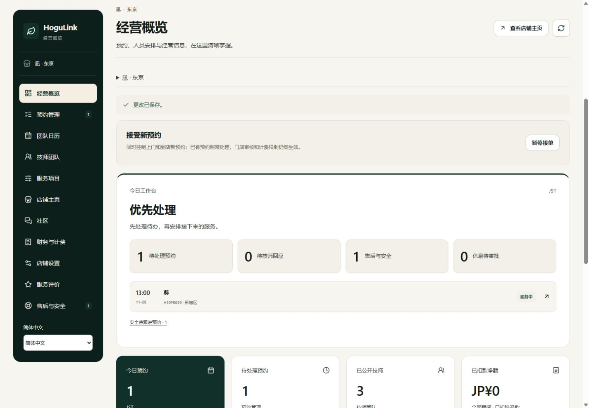

# 店铺端业务修复记录

日期：2026-11-06（日本时间）。同日[店铺专项测试](QA_MERCHANT_BUSINESS_AUDIT_2026-11-06.md)发现的两类 P2 问题均已修复，并通过 PC/H5 实测。代码尚未提交或推送。

## 改动与结果

| 问题                   | 修复后的行为                                                                                                                                              |
| ---------------------- | --------------------------------------------------------------------------------------------------------------------------------------------------------- |
| 安全升级不进入概览待办 | 店铺快照返回本店 `urgentSafetyBookingIds`，将升级签到与未结安全事件按预约去重。概览标题、安全数量、侧栏角标和安全跟进入口使用该汇总，不再显示虚假的无待办 |
| 超时服务从概览消失     | 仍在出发、到达、服务中的超时预约进入优先处理，并保留预约入口；计划结束时间不再代表实际服务已结束                                                          |
| 设备时间误禁用审批     | 店铺快照增加 `serverNow`，前端以服务端时间加单调经过时间计时。休息审批、默认日历日期、概览日期统计、不可约时间默认值、待机与订单提醒使用同一时间来源      |

安全计数按“需跟进的预约”统计，同一预约既有升级签到又有安全事件时仅算 1 条；普通待技师回应的 `WAITING` 签到不冒充店铺紧急待办。店铺记录联系结果不等于平台结案，仍保留安全待办；正式解决后移除。已完成预约若仍有未结安全事件，安全入口仍保留。

普通售后工单与安全预约分别统计后汇总到“售后与安全”；只返回本店安全预约编号，不增加平台处置正文、地址或其他店铺数据。审批、版本校验、接单与资金规则继续由服务端最终核验。日历轮询保留用户已选择的日期，新打开页面默认使用服务端的日本日期。

## 测试

| 检查                       | 结果                                                                     |
| -------------------------- | ------------------------------------------------------------------------ |
| 修复前新增用例             | 3 项后端用例、1 项超时履约模型用例先复现失败                             |
| 定向后端                   | 13 / 13 通过，含去重、异店隔离、联系后保留、结案清除、SOS 与等待签到区别 |
| 定向前端模型               | 6 / 6 通过，含审批截止边界、未校时保护、跨日和超时任务                   |
| 全量后端                   | 817 / 817 通过                                                           |
| 全量前端模型               | 187 / 187 通过                                                           |
| 演示素材                   | 5 / 5 通过                                                               |
| 业务 HTTP / SSR            | 20 组、2,132 项检查通过；店铺回归增加至 64 项                            |
| 全工作区类型检查及生产构建 | 通过                                                                     |

## 页面与接口交叉验证

使用独立网页 `qa.localhost:3128`、独立 API `127.0.0.1:4128` 和一次性内存数据库：

1. **设备偏快**：设备比服务端快约 4 小时，PC 和 H5 上两笔尚未到服务端开始时间的申请均可点击批准，实际状态均保存为 `APPROVED`。
2. **超时与安全升级**：同一订单同时有 `ESCALATED` 签到和 `OPEN` 安全事件，PC/H5 概览显示“优先处理”“1 待处理预约”“1 售后与安全”，并可打开仍为服务中的订单。
3. **联系与结案**：页面保存联系记录后安全数仍为 1；通过正常平台结案接口解决后安全数为 0。服务完成并由顾客确认后，概览回到真实的无待办状态。
4. **跨日与三语**：中日英概览正常。电脑仍为 11 月 6 日，服务端推进到 11 月 7 日后，新打开的手机团队日历默认显示 `2026/11/07`；没有修改电脑系统时间。
5. **交易未回归出错**：PC 实际受理、拒单后提议改派；顾客明确同意后替代技师确认并履约。原 ¥8,700 减去指名费 ¥500，顾客验收后实扣 ¥8,200；H5 实际退款 ¥500，剩余可退 ¥7,700。跨店、旧版本、超余额和代顾客验收均仍被拒绝，同店复购减半及退款费用冲回正确。

实现涉及 `merchant.ts`、店铺工作台与提醒、前端经营模型，复用已有 `server-clock.ts`。新增 `merchant-summary.test.ts`，扩充店铺模型与 HTTP 回归。

日志、截图和无凭据结果位于 `docs/qa-assets/merchant-fix-20261106/`；临时脚本、运行配置和凭据仅保留在本地忽略目录 `.qa/merchant-fix-20261106/`。测试为本地模拟支付和安全记录，没有真实扣退款或外部通知。原站 `3000/4000` 未用于测试写单，既有个人中心、技师修复、PC 样式和店铺界面改动均保留。
