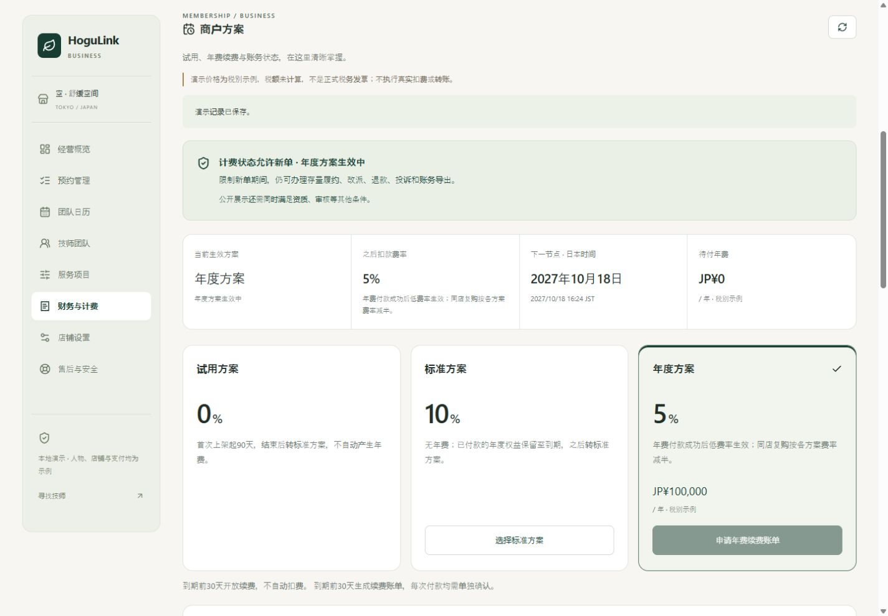

# 第二十一轮：商户方案、试用、续费与欠费处理

日期：2026-10-18。店铺与平台共用三语言响应式计费中心，联动订单履约、售后和上一轮账务核验。当前全部支付、年费回单与催缴为本地演示，不执行真实扣款、转账或正式开票。

## 产品依据与同行参考

依据 PRD V1.4 的 8.3、33.4、49.5、第 50 章及 AT-14：首次上架开始 90 天试用；试用结束默认 STANDARD；商户可选择独立年费的 ANNUAL；逾期经宽限期后按商户选择降级或暂停新展示/新预约，已有消费者权益继续办理。费率 0% / 10% / 5%、年费税别 ¥100,000 都是示例。

- [Stripe 试用生命周期](https://docs.stripe.com/billing/subscriptions/trials)：参考试用结束行为、到期提醒与权益生效条件分开的做法。
- [Stripe 订阅状态与欠费恢复](https://docs.stripe.com/billing/subscriptions/overview)：参考待付、失败、逾期与恢复状态，保留账单和失败尝试，而非用一个“已开通”开关代替支付事实。
- [Square 商户订阅管理](https://squareup.com/help/us/en/article/8309-manage-square-subscriptions)：参考同页管理试用剩余时间、费用、账单与到期降级；已付款的当前期间保留权益。

上述流程参考不替代本项目合同。本地实现不自动扣年费；下一年度生成待付账单，每次付款都单独确认。年费独立于顾客服务款，不从服务款结算金额中抵扣。

## 最终业务规则

| 阶段             | 系统行为                                                                     | 之后扣款费率                   |
| ---------------- | ---------------------------------------------------------------------------- | ------------------------------ |
| 等待首次上架     | 店铺、人员、服务满足公开条件后开始试用；上架前不产生年费                     | TRIAL 示例 0%                  |
| `TRIALING`       | 从首次可公开时刻开始 90 天，暂停/恢复不会重置试用                            | 0%                             |
| 试用结束         | 转 `STANDARD`，不自动生成年费                                                | STANDARD 示例 10%              |
| 申请年度方案     | 创建独立 `ANNUAL_PLAN_FEE` 待付单，原有效权益继续；开通申请 7 天未付自动作废 | 保持原方案                     |
| 年费支付失败     | 保留同一待付账单和尝试记录，不开通/延长年度权益                              | 保持原方案                     |
| 年费支付成功     | `ANNUAL_ACTIVE`；付款成功起一个日历年                                        | ANNUAL 示例 5%                 |
| 年度到期前 30 天 | 若仍选择年度续费，生成一份续费账单；不自动扣款                               | 有效期内继续 5%                |
| 提前续费成功     | 从原到期日顺延一个日历年，保留未用天数                                       | 5%                             |
| 到期前选择标准   | 保留当前已付年度权益，作废尚未到支付期限的待付续费单；到期后转标准           | 到期前 5%，之后 10%            |
| 年度到期仍待付   | `GRACE_PERIOD`，默认示例宽限 7 天，待付账单保留                              | 10%                            |
| 宽限期后选择降级 | `STANDARD`，可继续经营，原待付年费记录保留                                   | 10%                            |
| 宽限期后选择暂停 | `SUSPENDED`，停止新公开展示与新预约                                          | 存量单按当前 STANDARD 费率扣款 |
| 逾期后选择标准   | 按 STANDARD 恢复计费准入；保留原待付账单，不等同于免除账单                   | 10%                            |
| 逾期后补缴成功   | 从本次付款起开通一年；恢复计费准入，其他资格限制仍独立检查                   | 5%                             |

同店复购继续按对应费率减半；交通费、取消费和爽约费不计平台服务费。费率在实际服务扣款时冻结，后续退款按原扣款费用冲回，不重算历史费率。提前结束试用后不能重新领取。

日历年按 JST 周年计算，2 月 29 日在下一年钳到 2 月 28 日。方案期限、账单期限和权益区间全部显示完整年份和 JST，避免跨年度日期看似相同。

以上 7 天宽限、年费与试用天数是演示配置：`PLAN_GRACE_DAYS`、`ANNUAL_PLAN_PRICE_JPY`、`MERCHANT_TRIAL_DAYS`。正式费率、税额、续费和中止条件需按实际商户合同确定。

## 欠费、账单和存量订单联动

计费限制使用独立 `billingBlocked` 投影，不覆盖 `Store.active`、资质审批或人员授权。公开目录、店铺收藏/内容关联、复订、报价、保留、支付保障及提交新单均重新检查。改变方案不会绕过资格、肖像或内容暂停，年费支付也不会直接把商户审批设为通过。

限制期间继续提供：

- 原订单访问、店铺受理、技师确认、履约、同店改派与顾客明示同意。
- 原订单消息、顾客退款申请、原店铺实际退款、费用冲回、投诉和平台调查。
- 服务款流水、月度账单版本、账务导出及独立 PSP 服务款结算核验。
- 计费查询、年费补缴、选择降级、财务处理记录。

平台服务费分量与渠道回单不一致时，自动限制新展示/新单，直至财务更正核对数据。这个限制独立于年费；支付年费不能清除平台费差异。一般退款/净额差异继续按上一轮对账规则处理。

年费只保存在独立方案账单中，不写入服务款 `moneyEntries` 或按单平台费 `feeEntries`；服务款退款不会退年费或重开年费账单。欠费不扣减服务款结算核验金额，也不阻断原店铺独立核验服务款到账；上一轮的售后、账务一致性和渠道匹配限制继续生效。

原来演示登录列表依赖公开目录，导致隐藏后的店铺/技师无法被选中。本轮将虚构演示身份目录独立出来，并修复店铺、技师及售后工作台入口。目录只包含预置虚构名称和必要 ID，不枚举真实入驻账号或泄露支付路由；真实入驻账号仍使用自己的账号登录。

## 店铺端与平台端

入口为财务中心的“商户方案”页签：

- [店铺商户方案](http://127.0.0.1:3000/zh-cn/merchant?tab=finance&section=plans)：当前权益/费率/期限/待付四指标，三种方案卡，欠费偏好，到期转标准，年费账单、凭证与尝试记录。
- [平台商户方案](http://127.0.0.1:3000/zh-cn/admin?tab=finance&section=plans)：按店铺、待付或新单受限筛选，查看共同履历、记录演示渠道成功/失败、本地催缴及显式作废待付单。

店铺自行选择方案和逾期偏好。平台财务不能替商户选择付费方案，只有 `finance.write` 可记录入账结果、失败、催缴或作废待付单；AUDITOR 保持只读。已付款/已作废账单为最终状态，不提供作废已付款账单的旁路。

待付作废必须记录原因，已逾期年度改为 STANDARD 的处理可追溯；不发起服务款退款。催缴只进入本地队列，24 小时内同账单不重复记录人工催缴。

近 90 天方案测算使用真实完成且有剩余净扣款的订单，排除交通、考虑退款及复购优惠，年化比较费率差额与独立年费。没有订单时显示数据不足；税额与业务波动未纳入，明确标为参考测算，不默认替商户选年付。

PC 保持现有深绿/暖白、四列指标和三列方案卡；H5 转单列卡片及原生模态底部面板，手机新输入至少 16px，主要操作 44–48px，可键盘关闭并保持焦点范围。日/英/中全部提供状态、金额、错误、确认说明和日期。服务款财务页显示计费状态与待付年费，直接进入方案办理。

[平台计费队列](screenshots/admin-plans-pc.jpg) · [手机年费付款凭证](screenshots/annual-receipt-mobile.jpg)

## 接口与数据

以下均为 `/v1` 下的路径：

| 方法与路径                                       | 输入与权限                                                                                                                                      |
| ------------------------------------------------ | ----------------------------------------------------------------------------------------------------------------------------------------------- |
| `GET /merchant/subscription`                     | 本店，可选本店 `storeId`                                                                                                                        |
| `GET /admin/subscriptions`                       | `finance.read`，可选 `storeId`，含最小计费队列                                                                                                  |
| `POST /merchant/subscription/:storeId/actions`   | 本店；`version, action, note`，动作 `REQUEST_ANNUAL / SELECT_STANDARD / SET_OVERDUE_ACTION`；偏好动作还要求 `overdueAction=DOWNGRADE / SUSPEND` |
| `POST /billing/plan-invoices/:invoiceId/actions` | `version, subscriptionVersion, action, note`；动作 `PAY_SUCCEEDED / PAY_FAILED / VOID / REMIND`，后两项仅平台财务；成功还需 `reference`         |
| `GET /auth/demo-shops`                           | 预置虚构店铺身份，不受公开展示限制                                                                                                              |
| `GET /auth/demo-staff`                           | 预置虚构技师身份，供存量履约演示登录                                                                                                            |

旧的无账单 `merchant/billing/plan-changes` 接口已移除，不能直接传 `ANNUAL` 获得低费率或传 `TRIAL` 重领试用。财务工作台 `FinanceWorkspace.billing` 新增方案状态、待付年费、平台费差异与计费限制摘要。

所有新增写请求要求 `Idempotency-Key`。方案动作校验方案版本，账单动作同时校验账单和方案版本；同键不同输入拒绝，相同输入重试返回原不可变结果。成功年费回单编号为独立 `plan_` 命名空间并全局去重；同一店最多一笔待付年费，不能并发重复开通或续费。员工请求逐次核验当前角色和会话版本。

共享类型在 `packages/contracts/src/subscription.ts`。存储使用现有事务 records：`merchantSubscriptions`、`planInvoices`、`subscriptionEvents`、`subscriptionRetries`，并写最小审计和本地 outbox。方案账单 CSV 排除顾客、地址及服务款支付路由，继续处理公式注入。

现有本地到期扫描每 15 秒运行，也在业务事务前检查；UI 在可见时每 15 秒及重新聚焦刷新。打开确认面板后固定当时的对象和版本，状态变化要求重新核对，不能静默替换金额。

旧数据没有起止日期时，STANDARD 保留、TRIAL 从本次首次可公开起开始；旧 ANNUAL 权益按导入日起一年迁移并明确提示，不伪造已付款年费或历史回单。正式迁移必须核对真实历史合同及账期。

## 验收结果

| 项目           | 结果                                                                                         |
| -------------- | -------------------------------------------------------------------------------------------- |
| 后端测试       | 465 项通过，本轮新增 31 项方案生命周期测试                                                   |
| 前端/会话规则  | 53 项通过；总计 518 项                                                                       |
| 隔离 HTTP/SSR  | 1181 项通过，本轮新增 105 项                                                                 |
| 浏览器真实业务 | 31 项断言通过                                                                                |
| 三语多尺寸布局 | 132 组不同组合通过，320/390/768/1440px，覆盖试用/年度/逾期页面、账单、方案/政策/付款确认弹层 |
| 类型与构建     | 严格类型及生产构建通过                                                                       |

`hogulink-api/test/subscription.test.ts` 覆盖首次上架、试用不重置、到期边界、失败不授予权益、独立年费、提前续费顺延、闰年、到期转标准、宽限与两种逾期政策、补缴/作废、跨店/只读/撤权、版本与重试、唯一回单、本地提醒、旧方案迁移、资质和费用差异，以及受限商户继续履约、改派、退款、导出和独立服务款核验。

`scripts/smoke-subscription.mjs` 纳入 `npm run smoke:isolated`：实际 HTTP 权限与旧接口阻断、年费申请/失败/催缴/成功/重试、转标准安排、试用、后续年度费率履约和退款冲回，以及三语 SSR。

浏览器分别演练逾期商户降级/暂停、欠费期间原订单退款、平台查看失败与催缴、平台确认续费后店铺恢复、当前年度到期转标准、取消未到期续费账单，以及试用商户开通年费申请、失败重试和手机付款成功。确认退款 ¥1,000 仍按原年度扣款费用冲回 ¥44，年费 ¥100,000 独立保留。

证据保存在本机 `.qa/subscription-check.log`、`subscription-smoke.log`、`.qa/subscription/browser-results.json` 和本页截图。测试使用内存数据库与独立浏览器主机，不向主预览添加测试订单或替换主预览登录。视口检查不等同于真实设备验收。

## 后续接入

真实年费支付页面、PSP 签名回调/乱序防重、异步入账与失败补偿、正式税额及适格发票、可审校的续费合同、真实邮件/LINE 催缴送达、退款/贷项和按比例变更等合同例外、生产调度和财务双人审批仍需实现。当前“付款成功”是明确标识的演示记账动作，不能代替真实渠道入账证明。
