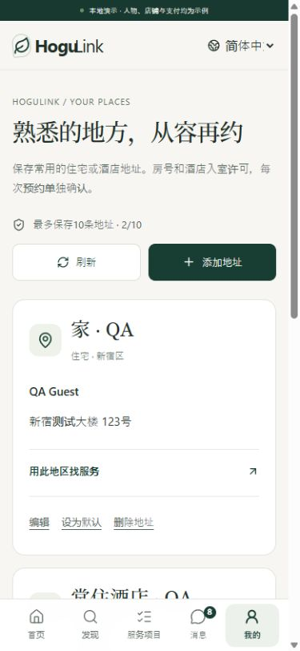

# 手机常用地址、预约与订单售后

更新：2026-10-18，第十七轮。当前为本地演示闭环，支付授权、扣款、退款和费用冲回均为模拟记录。

## 同行观察与本轮取舍

参考用户此前提供的东郊 H5 截图中「我的—订单—售后」的集中入口，以及 [HOGUGU 官方帮助](https://info.hogugu.com/guide.html)的公开流程：预约前由顾客确认酒店允许访客，预约变更和取消从对应预约处理。本轮据此强化每次预约的酒店确认与订单关联售后。没有使用同行登录账号，也没有直接验证其私有地址簿或后台。

沿用 HoguLink 自己的取消政策快照和收费规则；未移植同行费率。视觉保持深绿、暖白、细边框与克制留白，新增页面、表单与弹层均支持日文、英文和简体中文。

## 已实现的业务闭环

### 常用地址

- 「我的」和顾客导航进入 `/{locale}/account/addresses`，可新增、编辑、删除、切换默认地址，最多10条。首次保存自动成为默认；删除默认后从剩余条目选取有效默认，最后一条删除后为空。
- 地址簿存储在服务端且只允许已验证顾客本人访问。住宅/酒店、服务地区、姓名、楼宇和酒店名称有严格校验。房号、入室许可及未知字段不能写入地址簿。
- 以整个地址簿版本核对编辑、删除与默认切换，避免多窗口覆盖；新增使用与内容绑定的重试键，不重复新增，也不把已删除条目复活。冲突刷新版本时保留当前编辑内容。
- 「用此地区找服务」带入地区，选中地址只在当前标签页短暂保留不透明ID，地址正文不会进入网址。下单选择时重新核对地区和酒店限制；跨区地址或仅限酒店时的住宅会显示原因并禁选。
- 修改、删除常用地址不会修改已成立预约的地址快照。退出、会话失效或切换身份会清除页面私有状态及暂存草稿；迟到的旧会话响应不能覆盖新会话。

### 预约下单

1. 按现有供给、地区、语言、价格和时段生成报价并暂时保留。
2. 可选择常用地址或手填；默认地址仅在尚未输入/恢复草稿时建议带入。酒店房号和入室许可每次重新确认，切换地址或变更酒店信息后清除许可。
3. 完成演示支付认证，核对本次政策，再打开最终确认。弹层展示服务店铺及经营主体、项目、指定/店铺安排、时间、具体地点、费用、扣款时点和取消政策。关闭弹层不下单。
4. 确认后使用稳定重试键提交。重复点击、重试或重新打开已提交的保留页均找回同一订单；结果找回不重新授权、不重复生成订单，也不依赖当前价格仍与原价一致。
5. 认证失败释放保留并禁用原结算，重新选择时段后恢复基础地址；新的酒店预约不沿用旧房号或许可。草稿绑定顾客和保留ID，有30分钟期限，关闭浏览器存储时核心流程仍可用。

### 订单售后

- 单笔订单展示真实预约阶段、已扣款、已退款和当前剩余可申请金额，关联本人发起的工单。仅授权未扣款不能当作已退款资金；进行中的服务问题仍从原订单发起。
- 只有已结束且有未退实扣款的订单可申请退款。申请金额为正整数日元、不超余额、原因10—1000字；每单最多一个待处理申请。退款申请与共享工单在同一事务创建，重复请求只产生一份；工单数量上限失败时整体回滚。
- 原服务店铺核对版本、当前余额和说明后，可全额、部分批准或拒绝。批准调用既有退款台账与平台费冲回；重复或并发处理不产生第二次财务效果。部分批准明确展示实际退款额，顾客可按剩余余额再申请。
- 顾客可确认撤回，撤回不退款；店铺拒绝不退款且保留沟通及平台升级渠道。待决定申请不能被普通「记录处理结果」提前结案。
- 平台依原有权限查看、分派与处理争议，退款执行归原店铺。已经升级平台的工单，即使退款批准或顾客撤回，也保持平台处理中，等待争议处理。
- 退款申请不自动取消服务，普通工单结案也不自动退款。已有取消费用预览、快照校验、改派、爽约与安全流程继续保留。

## 接口

以下均在 `/v1` 下；JSON 严格校验，涉及金额均为整数日元。

| 方法   | 路径                                     | 要点                                                                             |
| ------ | ---------------------------------------- | -------------------------------------------------------------------------------- |
| GET    | `/customer/addresses`                    | `{version,defaultId,items}`，本人私有                                            |
| POST   | `/customer/addresses`                    | `{version,label,setDefault,address}`，必须带 `Idempotency-Key`，201              |
| PUT    | `/customer/addresses/:id`                | 同上；核对全簿版本                                                               |
| DELETE | `/customer/addresses/:id`                | `{version}`，删除及默认回退                                                      |
| POST   | `/customer/addresses/:id/default`        | `{version}`，设为唯一默认                                                        |
| GET    | `/booking-holds/:id/submission`          | 本人 `{bookingId:null                                                            | string}`；已提交结果恢复 |
| GET    | `/customer/bookings/:id/care`            | 本人实扣、实退、剩余、申请与工单摘要                                             |
| POST   | `/customer/bookings/:id/refund-requests` | `{bookingVersion,amount,reason,locale}`及重试键，201                             |
| GET    | `/support-tickets/:id/refund-request`    | 原工单授权范围内的申请、余额和订单版本；技师不可读                               |
| POST   | `/refund-requests/:id/decision`          | `{version,bookingVersion,action,amount,text}`及重试键；`APPROVE/REJECT/WITHDRAW` |

退款申请状态：`PENDING / APPROVED / PARTIALLY_APPROVED / REJECTED / WITHDRAWN`。它与原工单状态、支付状态分别记录。版本陈旧、余额变化、越权和改变输入复用重试键均拒绝。

## 验收

- `npm run check`：401项测试通过，352后端＋49前端/会话规则；严格类型与生产构建通过。本轮新增29项，覆盖地址权限、默认并发、恢复原单、财务一致性、部分/拒绝/撤回/升级、工单上限回滚、草稿兼容性、存储被禁和旧会话401竞争。
- `npm run smoke:isolated`：812项 HTTP/SSR 断言通过，包括新增66项地址、结算恢复和售后跨角色检查。新增套件独立启动全新内存库，避免继承之前用例的演示登录频控和业务配额；没有放宽应用频控。
- 手机浏览器28条实际操作断言通过：建址、默认、适用限制、房号/许可重填、最终核对、下单、重复进入恢复、部分退款、撤回、拒绝后平台升级、地址编辑/删除、历史快照、失败重选、退出隐私与重新登录。
- 120组布局通过：日/英/中三语，320/360/390/430/1440视口；覆盖地址簿、编辑弹层、结算、地址选择、最终确认、订单售后、退款申请弹层和顾客退款工单。核对文档横向溢出、单一主标题、手机字段16px、弹层宽度和焦点包含；另实际操作商户与平台售后手机页面。未发现浏览器错误日志。
- 浏览器仅使用 `localhost:3001` 和独立内存 API `4118`，与主预览 `127.0.0.1:3000/4000` 分开。测试订单、地址和退款均为虚构夹具；未改主预览会话或向主库写测试交易。浏览器验收记录在 `.qa/mobile-checkout/browser-results.json`，测试日志在同目录。

## 尚需接入

真实身份、支付渠道异步退款与失败补偿、送达通知、正式条款、加密存储/保留清理、完整地址/邮编校验、营业日历、附件证据、SLA、真机键盘与读屏验收仍未完成。模拟退款成功不代表真实银行到账。本轮没有新增同行充值卡、优惠券或未经核实的销量/评价。
