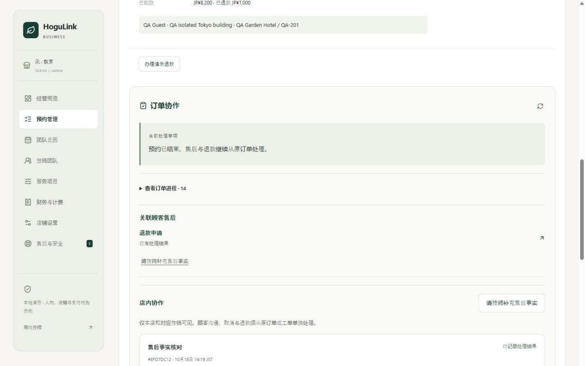
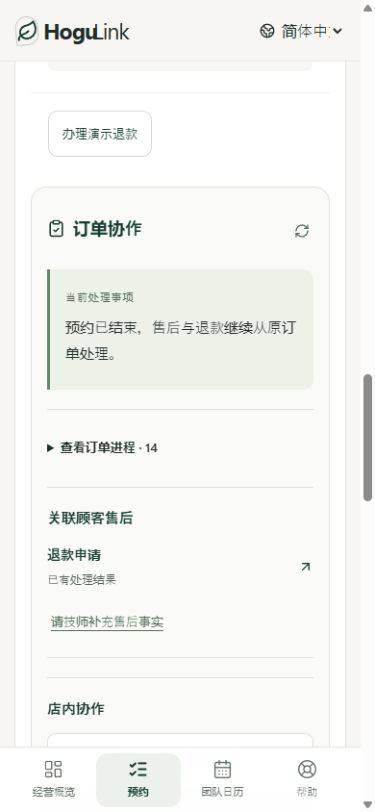

# 店铺、技师与顾客订单联动

第十九轮补充：订单协作已增加按角色和实际条件过滤的最小平台关注提示；顾客仅见本人到达延迟，店铺/当前技师见必要履约异常，不含平台内部说明、负责人和私密工单。平台调查、原店铺执行与重新申诉闭环详见 [平台治理说明](PLATFORM_ORDER_GOVERNANCE.md)。

更新：2026-10-18，第十八轮。保留深绿、暖白、细边框与克制留白，日文、英文、简体中文覆盖 PC 和手机。当前为本地演示，未接入真实支付或通知。

## 同行观察与实现范围

参考 [くらしのマーケット店铺预约管理](https://faq.curama.jp/docs/shop/reservation-handling-schedule/)、[店铺变更与取消](https://faq.curama.jp/docs/shop/reservation-changes-and-cancellations/)及 [HOGUGU 公开帮助](https://info.hogugu.com/guide.html)：预约记录承载进度、变更与完成，店铺自身无法履约应区分取消原因。本轮据此集中订单处理和异常跟进；未登录同行私有后台，也没有复制其费率、合同或品牌视觉。

HoguLink 的商户合同主体、技师任务确认、指名改派明示同意、免指名费及原店铺售后责任继续依本项目 PRD。技师确认任务不替代店铺受理，店内事实协作不替代顾客工单或退款。

## 已跑通的链路

1. **接单**：顾客提交后，人工店铺以店铺名义受理，再派发内部任务。未派发时不能由技师确认。自动受理和 SOLO 的既有独立规则保留。
2. **技师确认**：本人确认任务后才展示当前履约所需地址；按出发、到达、开始、完成依次推进。原订单保留商户、原指名与最终执行人员三个事实。
3. **无法履约**：技师报告店铺情况或撤回任务；已确认指名单保留订单状态并进入改派子流程，页面明确等待店铺安排，不继续显示双方均已确认。
4. **改派**：店铺选择符合项目、语言、酒店条件、资质、值守及日程的同店人员。指名单等待顾客明确同意；不指名单由店铺直接分配。顾客同意后免指名费，新技师仍须本人确认；顾客拒绝则按既有店铺原因免费取消。
5. **重新选人**：新增撤回当前替代人选，释放其保护时段，保留原响应期限和原订单身份。撤回不等于顾客同意，也不恢复原技师履约权限；店铺可重新提议或取消。
6. **完成与售后**：完成后记录演示扣款，用户订单可发起退款。店铺订单直接链接对应顾客工单，显示待决定退款，可请对应技师补充事实。技师答复后，店铺记录内部处理结果，再独立决定顾客退款；部分退款回到同一顾客订单的实际余额。

## 新增订单协作

顾客单笔订单、店铺选中订单及技师任务均显示当前处理事项与真实事件进程。响应期限只在等待受理、派单、确认或改派时展示；服务阶段提示依实际任务子状态，避免仅凭 `CONFIRMED` 推断技师仍可履约。

- 进程来自实际审计事件白名单，只返回事件ID、类型和时间；不返回操作者标识、内部说明、顾客地址或支付路由。新审计记录保存订单版本，时间相同时仍按业务发生次序展示。
- 顾客看到受理、派发、改派、确认、履约和退款事件。技师不收到退款事件或顾客工单摘要；原服务店铺仅见共享给本店的顾客工单。
- 订单协作和技师待办在页面可见时定期刷新，订单版本变化会刷新父级详情；切回窗口也会重新核对。现阶段为站内轮询，不代表短信或 LINE 已送达。

### 店内事实协作

技师可发起「履约备注 / 服务问题」；店铺可发起「售后事实核对」，可关联本订单对本店可见的顾客工单。接收人从服务端实际派单解析，客户端不能指定其他技师。

状态为 `WAITING_STAFF → WAITING_SHOP → RESOLVED`，可往返说明，由店铺记录结果或重开。每次创建和操作均核对版本、使用与内容绑定的重试键；并发只有一个版本成功。

- 顾客和其他店铺不可读取；本店与对应技师可见。顾客私有投诉正文、退款决定和财务余额不转给技师。
- 改派后，原技师失去订单地址、消息和履约权限，仍可在「店铺协作待办」补充自己的原任务事实。该待办仅含订单号、时间、状态和对应协作，不包含地址、顾客标识或支付信息。
- 人员解绑或归属失效后，原协作访问也撤回。没有有效接收人的订单不能新建协作；店铺仍可办理既有合法善后。
- 每单最多10条未结束协作，每名接收人在本店最多100条未结束协作，确保待办上限内仍可处理全部未结束项；已结束部分显示最近记录。每条最多50条常规说明，达到上限后仍允许店铺记录结果，避免无法结案。
- 记录协作结果只结束这条内部协作，不改变预约、顾客工单、支付或退款。紧急安全情况仍使用既有安全签到、SOS 和平台处置链路。

## 改派与页面边界修复

- 展示候选、执行改派及顾客批准时重新核对当前人员条件；条件变更后不静默换人、不沿用失效资格。原替代人选被保护的时段在事务内释放后再次核对冲突，失败回滚，不丢失保护。
- 即时改派排除仍在服务或已逾原计划结束仍在途中/到达的技师，不仅检查原日历区间。
- 待改派同意期间，原技师消息读写与履约入口均阻断，和地址撤回保持一致。
- 指定订单链接失效时明确提示，不自动选中另一笔订单；可从列表主动重选。切换身份或订单时清除旧详情、消息草稿和确认弹层。
- 店铺安全提醒仅在合法店铺身份后读取，切换店铺重新挂载；成功刷新清除旧错误。店铺订单消息入口改为「联系顾客」。

## 接口

均位于 `/v1`；身份、店铺、原任务接收人和可见范围由服务端判定。

| 方法 | 路径                                            | 请求 / 返回                                                                        |
| ---- | ----------------------------------------------- | ---------------------------------------------------------------------------------- |
| GET  | `/bookings/:id/coordination`                    | 当前订单版本、服务端时间、事件进程、当前角色可见协作、店铺可见顾客工单最小摘要     |
| POST | `/bookings/:id/handoffs`                        | `{bookingVersion,topic,text,ticketId?}`，重试键，201；可见接收人固定为实际获派人员 |
| GET  | `/staff/handoffs`                               | 本人有效归属下的最小待办，未结束优先，最多100条；原任务改派后仍可处理对应事实      |
| POST | `/work-handoffs/:id/actions`                    | `{version,action,text}`＋重试键；`REPLY/RESOLVE/REOPEN`，结果和重开仅原店铺可用    |
| POST | `/merchant/bookings/:id/replacement-withdrawal` | `{version,reason}`，原因10—300字；不延长改派确认期限                               |

协作文本10—1500字，未知字段拒绝。其创建或回复不会增加订单版本，避免把事实沟通误当成交易变更；协作版本单独核对。顾客工单和退款继续使用上一轮接口。

## 验收记录

- `npm run check`：**425项测试通过**，372后端、53前端/会话规则；本轮新增24项。严格类型和生产构建通过。
- `npm run smoke:isolated`：**886项 HTTP/SSR 检查通过**，新增74项覆盖人工受理、任务确认、撤回和重选人选、顾客同意、原技师访问撤回与事实留存、替代技师履约、顾客退款、店铺核实与部分处理，以及不指名单直接派发。
- **23条浏览器实际操作断言通过**，从人工接单一直到同一用户订单显示实退金额；另验证失效订单链接、旧技师隔离和店内结案不关闭顾客退款。
- **112组页面/弹层检查通过**：日文、英文、简体中文；320、390、768、1440视口；店铺订单/事件进程/事实请求、技师任务/事实报告、原技师协作待办、顾客订单进程，以及中文候选撤回、履约完成、协作结果确认。核对横向溢出、可见主标题、手机字段字号、弹层焦点与宽度，无浏览器错误日志。
- 验收浏览器使用 `localhost:3001`、内存 API `4119`，与主预览 `127.0.0.1:3000/4000` 分开；未改主预览会话或向主库写测试交易。日志和操作记录位于 `.qa/coordination/`。

## 仍待生产接入

真实身份、PSP授权/扣款/异步退款与对账、可靠通知、完整营业/交通规则、正式 SLA、附件与证据保全、真机键盘/读屏和 PostgreSQL 并发验收仍待完成。当前演示允许快速推进未来任务以测试联动，不能据此宣称真实到达或服务时长已核验；详情中的出发、到达和完成是授权人员自报记录。
