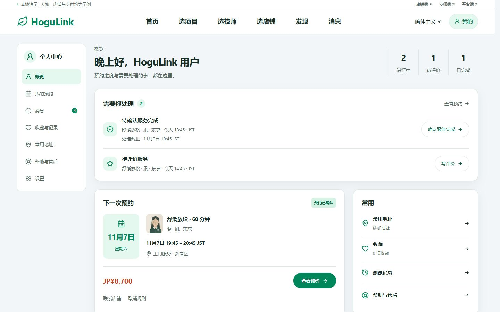
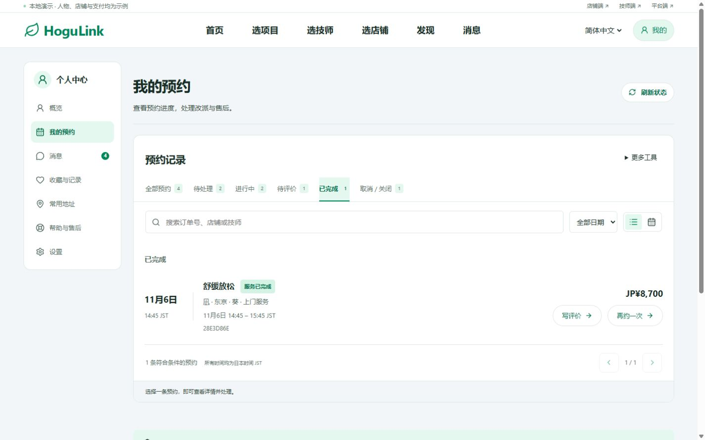
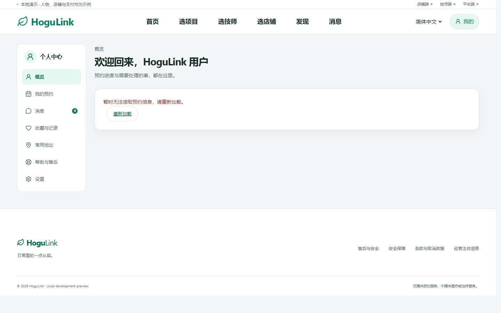
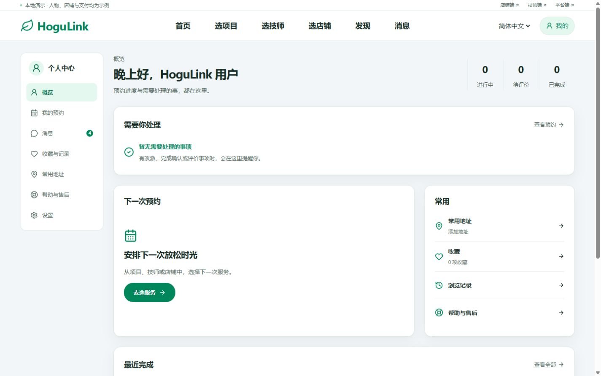
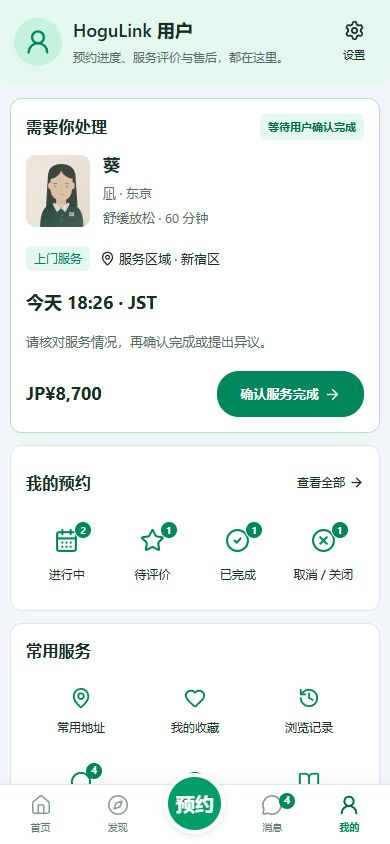

# PC「我的」改造与验收

日期：2026-11-06（日本时间）。本轮结合用户提供的 Claude 方案及现有实现，改造 1101px 及以上的顾客个人中心、预约列表、设置与收藏入口。现有 H5 绿色体系、业务规则和手机端布局保持。

## 已实现

1. **概览**：问候与真实数量缩成一行；待办按改派确认、完成确认、支付认证、评价排序；下一次预约与常用资料分为主次两列。没有未来预约时仍保留需要跟进的当前订单，不把售后处理中订单误当成空账号。
2. **待办**：从完整的本人订单中选取，不受“最近三单”限制；全部先进入原订单核对，再执行同意改派、验收、支付认证或评价。截止时间使用服务器时间；到期后刷新摘要。
3. **最近完成**：从全量完成记录中独立选取最近三笔，展示再约与符合条件的评价入口。取消、拒绝和过期订单只在预约列表中查看。
4. **预约列表**：PC 默认按待处理、进行中／即将到来、已完成、已取消／关闭展示紧凑行；保留查询、状态、日期、分页、日程和导出。切换“已完成／待评价”等筛选后使用对应标题；同一订单在默认分组中只出现一次。
5. **设置**：PC 使用左侧分区导航与右侧内容，包括语言、账号与登录、常用地址、隐私与条款；退出保留在底部。手机端仍显示原有返回箭头、列表和手机网页说明。
6. **导航**：侧栏首项改为“概览”，“收藏与记录”内可切换收藏与浏览记录；消息使用真实未读数。顶部“我的”保留头像入口与选中态。
7. **空与失败**：零地址可直接打开添加表单；读取中不显示零数量；读取失败提供重试，不能显示“暂无待办”；其他角色进入个人中心仍可返回其工作台。

没有增加优惠券、积分、储值或会员占位。

## 数据与边界

原 `customer/overview` 的 `recent` 只有三笔，不能可靠提供所有待办、下一次预约及较早的完成记录。本轮为该接口增加 `desktop` 只读摘要：`actions`、`upcoming`、`recentCompleted`、`savedPlaces`。原有计数、H5 focus、最近三单及评价资格接口保持。

- 只读取当前顾客的订单；摘要不返回门牌号、房号、联系方式、支付编号或其他顾客记录。
- 完成确认只提醒仍需顾客处理的记录；已提出异议的记录不提示重复确认。服务结束后支付授权失效仍可显示支付待办，进入原订单重新核对。
- 支付失败且已经释放的未提交保留，不伪造“待支付订单”；只有有效保留才提供继续预约入口。
- 再约继续使用现有接口，带入项目、人员安排、服务方式及地区，重新选择时间、确认现价，不复用旧地址或旧时段。
- 公开目录读取失败时，原订单仍可访问；无法读取已分配技师的公开资料时，PC 显示“技师信息请查看预约详情”，不误报“未分配技师”。

## 验证

隔离环境：Web 3116、API 4116、内存数据库，邮件与后台任务关闭。一次性测试脚本留在忽略目录 `.qa/pc-account-implementation-20261106/`。通过现有预约、履约与取消流程创建已完成、待确认完成、未来已确认、已取消四种测试订单；另外使用受保护的隔离状态注入检查改派及支付提醒。未修改主预览数据库，未代用户在公网提交订单或付款。

| 验证 | 结果 |
| --- | --- |
| 后端完整测试 | 807/807 通过。包含新增的摘要完整性、归属隔离、授权失效提醒及常用地址数量隔离检查。 |
| 前端测试 | 182/182 通过。包含待办顺序、评价资格、未来预约顺序及不改变 H5 原列表的检查。 |
| 全工作区类型检查及生产构建 | `npm run build` 通过。 |
| 三语与 PC 宽度 | 中文、英语、日语 × 1101／1440／1920 × 概览／预约列表／设置，共 27 个页面检查，无横向溢出。 |
| 手机回归 | 390px 概览、预约列表与设置保持原结构，无横向溢出。 |
| 真实页面入口 | 写评价进入原订单并打开评价表单；再约带回正确项目并重新选时段；联系店铺自动打开原订单消息区域，未发送消息。 |
| 空与异常 | 零订单、零地址、概览读取失败与点击重试恢复通过；失败时不显示零计数和空待办结论。 |
| 本地主站 | 用户端 3000 的个人中心返回 200；4000 API 健康状态 ok。 |

测试环境已关闭，原本地项目保持运行。临时构建配置改动已还原。

## 验收截图

PC 最终概览（虚构测试数据）：

完成记录筛选、评价及再约入口：

读取失败与成功读到零订单是两种独立状态：

手机原布局回归：

## 交付状态

本地代码已完成，尚未提交、推送或部署。沿用上一轮未提交的 HTTP 编号兼容与弹窗滚动修复，没有覆盖这些改动。

本轮没有再次验收真实支付渠道、浏览器全矩阵或完整读屏兼容。自动测试日志与 27 页尺寸检查记录保留在 `.qa/pc-account-implementation-20261106/`。
