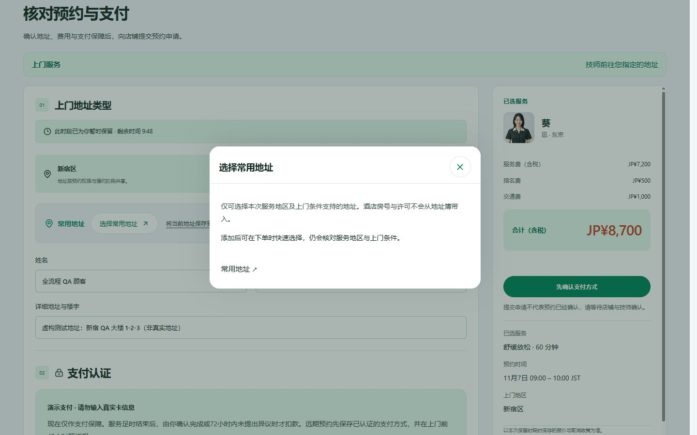
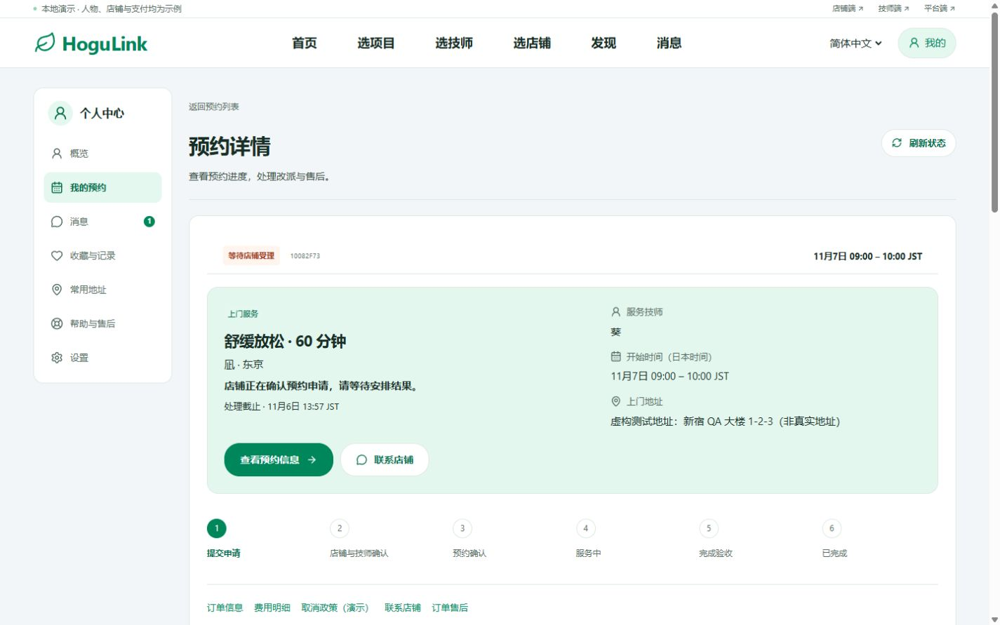
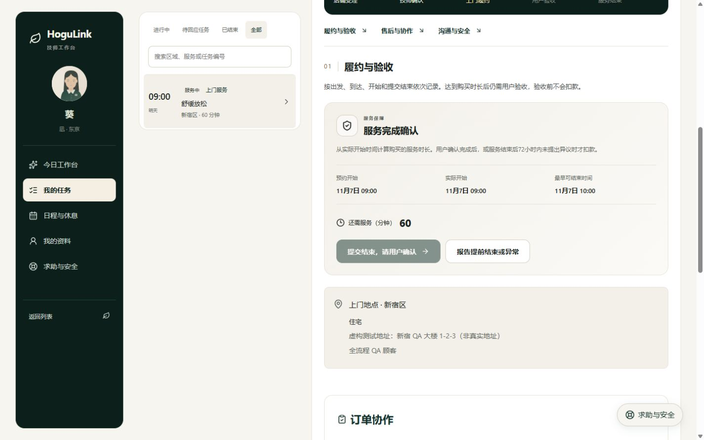
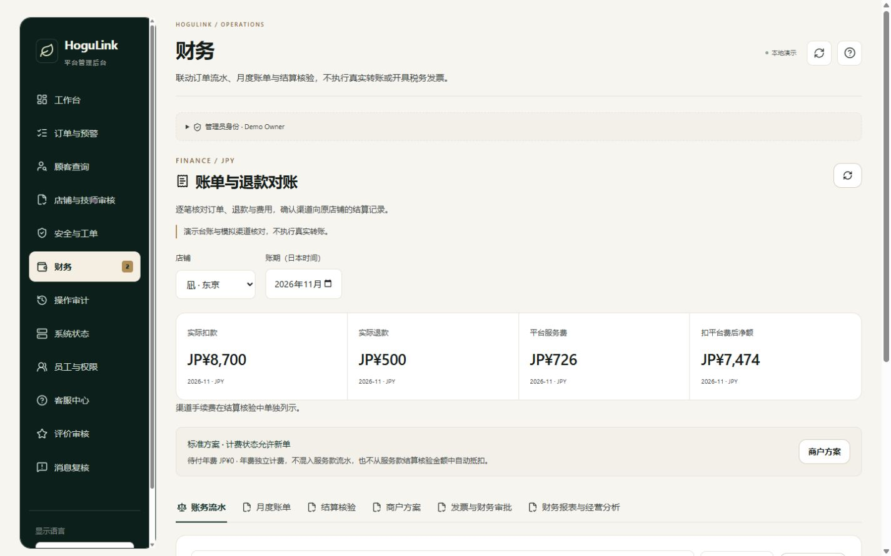
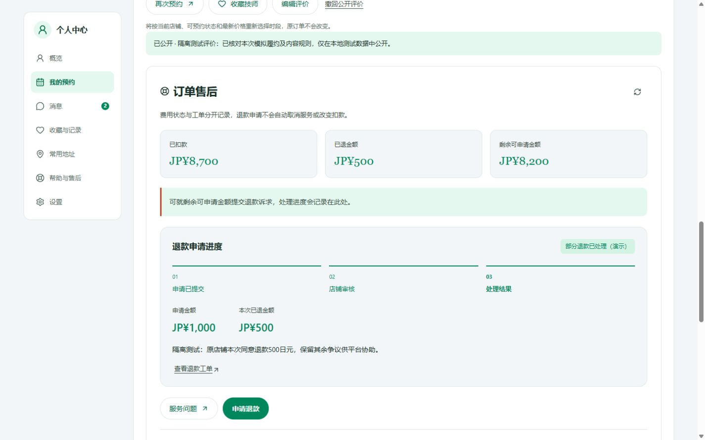
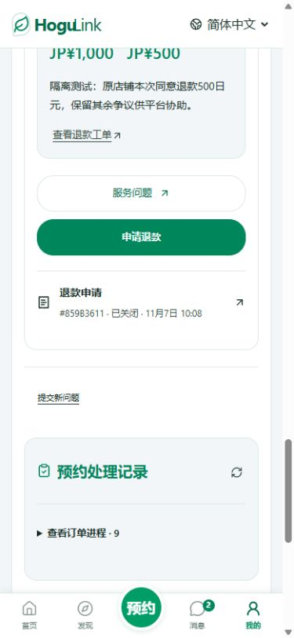

# HoguLink 四端业务流程测试报告

测试日期：2026-11-06（日本时间）。

本报告记录首轮顾客、店铺、技师、平台成交与售后闭环检查。同日技师专项复查发现安全终止越界、退款财务字段暴露、设备时间误拦截三类问题，**后续均已修复，新增边界测试及 PC/H5 实测通过，详见 [技师端业务修复记录](STAFF_BUSINESS_FIXES_2026-11-06.md)。** 下列数量保留首轮执行口径；最新回归为后端 814 项、前端模型 184 项、素材 5 项、20 组业务流程 2,125 项及类型检查和生产构建通过。页面实际操作与自动检查分别记录，不能将自动断言数理解为人工点击用例数，也不能据此认定真实支付、真实通知已可上线。

同日[店铺专项测试](QA_MERCHANT_BUSINESS_AUDIT_2026-11-06.md)发现的安全待办漏计和设备时间误禁用审批，后续均已修复，详见 [店铺端业务修复记录](MERCHANT_BUSINESS_FIXES_2026-11-06.md)。最新回归为后端 817 项、前端模型 187 项、素材 5 项、20 组业务流程 2,132 项，以及类型检查和生产构建通过；原始执行明细保留历史口径。

## 1. 测试版本与隔离范围

- 基于当前本地工作区，基准提交为 `4fa74df9b809afc9f28058868508fa6b6560a433`。包含此前尚未提交的 PC 个人中心、弹窗、请求标识及店铺界面等改动，并非只测试该提交的干净版本。
- 测试开始保存了工作区差异与 461 个源码、配置及测试文件的 SHA-256；测试结束复核源码未发生变化。本轮新增报告与截图，未修改业务代码、提交、推送或部署。
- 页面操作使用独立测试站 `http://qa.localhost:3120`，独立 API 使用 `127.0.0.1:4120`，数据库为内存库。原站 `3000/4000` 的订单和支付数据未参与写入。
- 支付为本地模拟；通知不投递到真实邮箱、LINE、短信或紧急联系人。姓名、地址、评价和工单内容均为虚构测试资料。
- 自动流程测试自行启动独立内存 API；服务端页面检查读取本地预览。账号测试使用本地邮件接收器，未发送真实邮件。
- 同一测试浏览器内依次通过页面切换四种演示身份；没有声称四个身份是同时独立登录的四个浏览器。

## 2. 自动检查结果

| 检查                       | 结果                    | 说明                                                   |
| -------------------------- | ----------------------- | ------------------------------------------------------ |
| 后端测试                   | 807 / 807 通过          | 预约状态、价格、权限、并发约束、履约与财务等           |
| 前端模型测试               | 182 / 182 通过          | 目录、个人中心、业务展示、错误与会话处理等             |
| 演示素材检查               | 5 / 5 通过              | 文件存在、可解码及上传规格等                           |
| 四端业务回归               | 20 组、2,078 项检查通过 | 独立 API 写入与页面服务端输出检查                      |
| 账号完整流程               | 37 项检查通过           | 注册、验证、找回密码、会话撤销等，本地邮件接收         |
| 本次页面订单的四端最终核验 | 45 项断言通过           | 原订单归属、只扣款一次、部分退款、余额、权限和工单关闭 |
| 类型检查与生产构建         | 通过                    | `npm run build`，含所有工作区类型检查                  |

本轮各类自动检查合计 3,154 项，其中单元、模型及素材测试为 994 项；其余为流程和结果断言，统计口径不同。

### 20 组业务回归明细

| 组别           | 检查数 | 主要覆盖                                           |
| -------------- | -----: | -------------------------------------------------- |
| 基础预约       |     80 | 下单、归属、支付与退款                             |
| 售后与安全     |     90 | 工单、限制申诉、店铺隔离、安全处理                 |
| 店铺工作台     |     57 | 店铺管理与订单处理                                 |
| 技师工作台     |     79 | 本人任务、日程、履约、安全与地址权限               |
| 平台工作台     |     97 | 平台审核、订单与角色权限                           |
| 工单跟进       |     70 | 认领、安排、处理结果与权限                         |
| 员工与权限     |     96 | 邀请、角色、调度、会话撤销                         |
| 服务体验       |    101 | 评价、回复、申诉、收藏、再约、取消预览             |
| 内容与消息     |    104 | 发现、收藏、私有消息、已读快照                     |
| 顾客流程       |     74 | 地址、结算恢复、原店铺退款                         |
| 订单协同       |     78 | 人工受理、改派撤回、用户同意、技师交接、退款关联   |
| 平台治理       |    108 | 跨角色事实、调查结论、店铺执行、回执、结案、重开   |
| 财务           |     94 | 扣款、退款、账单修订、渠道差异、争议、失败与结转   |
| 商户方案       |    109 | 试用、年度账单、重试、续费选择、权限与售后关联     |
| 发票与财务审批 |    121 | 隔离数据下的发票和审批流程                         |
| 经营报表       |    121 | 范围、日期、快照、隐私、退款结转、年费与发票关联   |
| 完成验收       |    132 | 时长、异议、72 小时验收、超时、重新授权、只扣一次  |
| 到店服务       |    106 | 门店审核、容量、结算、签到、服务、验收与再约       |
| H5 与三语输出  |    303 | 手机端合同约束及中、日、英服务端页面输出           |
| 店铺主页       |     58 | 私有草稿、图片权限、审核、撤回、版本冲突与三语输出 |

完整流程日志与最终结果保存在本报告同目录的 `qa-assets/all-roles-20261106` 中。

## 3. 页面实际操作：一笔订单贯穿四端

测试订单：`10082F73`（完整 ID：`booking_61e58c84-aa73-44fa-a826-915b10082f73`）。

店铺「凪 · 东京」，技师「葵」，指定技师、上门服务、新宿区、60 分钟，预约时间为 11 月 7 日 09:00–10:00 JST。

| 步骤 | 操作身份与页面                     | 实际结果                                                                             |
| ---- | ---------------------------------- | ------------------------------------------------------------------------------------ |
| 1    | 顾客：首页 → 技师目录 → 详情       | 可选择服务方式、地区、次日日期与时段，显示含税总价 ¥8,700                            |
| 2    | 顾客：登录后返回预约               | 地区、项目、指定技师和时段保留                                                       |
| 3    | 顾客：模拟支付认证失败             | 时段释放，不能继续提交；有明确重新选择入口                                           |
| 4    | 顾客：重新选择并进入结算           | 原姓名及虚构地址保留，重新取得时段，不沿用失败支付                                   |
| 5    | 顾客：常用地址弹窗                 | PC 弹窗居中；关闭后可继续填写和滚动                                                  |
| 6    | 顾客：模拟认证成功、核对并最终提交 | 创建 `REQUESTED` 订单；店铺人工受理，支付已授权但未扣款                              |
| 7    | 店铺：待办 → 订单 → 以店铺名义受理 | 进入等待技师确认；受理不等于预约已确认                                               |
| 8    | 技师：本人任务 → 确认承接          | 确认前隐藏详细地址；确认后仅本人可查看履约地址                                       |
| 9    | 履约时间限制                       | 出发记录开放前按钮禁用；到达后未到预约开始时间不能开始                               |
| 10   | 技师：开始服务                     | 到预约时间后通过页面二次确认开始；未满 60 分钟不能提交正常结束                       |
| 11   | 技师：足时后提交结束               | 进入 `AWAITING_COMPLETION`；顾客验收前实际扣款仍为 ¥0；技师详细地址再次隐藏          |
| 12   | 顾客：核对服务记录 → 验收          | 显示将扣 ¥8,700，需勾选已核对时长；完成后仅产生一笔扣款                              |
| 13   | 顾客：评价这次服务                 | 五项评分和说明提交后显示待审核，未直接公开                                           |
| 14   | 顾客：申请退款 ¥1,000              | 退款请求与原订单、原店铺工单关联，订单未被自动取消                                   |
| 15   | 店铺：本次同意退 ¥500              | 最终确认明确提示部分退款；执行后显示实际 ¥500，余额 ¥8,200                           |
| 16   | 顾客：原工单申请重新处理           | 同一工单进入平台处理；没有创建脱离原订单的新退款事实                                 |
| 17   | 平台：认领、记录内部调查安排       | 内部备注与对外回复区分；顾客看不到内部安排                                           |
| 18   | 店铺：补充共享陈述                 | 平台可引用店铺陈述及顾客原始申诉形成结论                                             |
| 19   | 平台：发布跟进说明结论             | 店铺未执行前禁止结案；发布结论没有新增扣款或退款                                     |
| 20   | 店铺：提交执行回执                 | 跟进说明的执行结果进入可结案状态                                                     |
| 21   | 平台：记录处理结果                 | 工单显示已有处理结果，内部跟进记录只读                                               |
| 22   | 平台：审核评价                     | 核对四项内容规范后通过，本地测试评价移出待审核队列                                   |
| 23   | 顾客：确认结果并关闭               | 原工单 `CLOSED`；退款事实保持 ¥500，未重复退款                                       |
| 24   | 平台：财务                         | 显示唯一扣款、唯一退款及服务费冲回，两条流水关联同一原订单                           |
| 25   | 顾客：「我的」与再次预约           | 进行中 0、待评价 0、已完成 1；再次预约需要重新选择服务方式和当前可约时段，原订单不变 |

**时间模拟说明：** 次日、预约开始及足时结束由隔离 API 的测试时钟推进，没有改变电脑时间。出发、到达两步通过隔离 API 驱动，其余上述关键成交及售后操作通过浏览器页面完成。技师出发按钮使用浏览器本地时间，测试时钟推进不会同步改变它，因此不能将出发、到达两步计为实际点击验证；其正常和异常状态由自动流程覆盖。

## 4. 金额与权限核对

| 项目               | 最终金额 / 状态     | 证据                                                |
| ------------------ | ------------------- | --------------------------------------------------- |
| 服务费             | ¥7,200              | 冻结报价                                            |
| 指名费             | ¥500                | 冻结报价                                            |
| 交通费             | ¥1,000              | 冻结报价，不进入平台费基础                          |
| 原订单合计         | ¥8,700              | 四种角色读取一致                                    |
| 顾客验收前扣款     | ¥0                  | `state-waiting-customer` 快照                       |
| 实际扣款           | ¥8,700              | 仅一条 `CAPTURE` 流水                               |
| 请求退款           | ¥1,000              | 原退款请求                                          |
| 实际退款           | ¥500                | `PARTIALLY_APPROVED`，仅一条 `REFUND` 流水          |
| 剩余可申请金额     | ¥8,200              | 顾客、店铺和财务一致                                |
| 原平台服务费       | ¥770                | `(7,200 + 500) × 10%`，本笔演示标准方案配置         |
| 平台费冲回         | −¥44                | 关联原扣款流水                                      |
| 平台服务费净额     | ¥726                | `770 − 44`                                          |
| 店铺扣平台费后净额 | ¥7,474              | `8,700 − 500 − 726`，渠道手续费另列，非真实到账凭证 |
| 订单状态           | 已完成 / 已部分退款 | 四端一致                                            |
| 售后工单           | 已关闭              | 顾客确认后关闭原工单                                |

权限核验：其他店铺与其他店铺技师无法读取该订单；技师结束服务后不再获取详细地址。更广泛的员工权限、会话撤销、工单隔离和角色财务权限包含在自动回归中。

收费模式、试用期、年费、复购减半、支付归属及现有合同规则均未在本轮改变。上述金额仅为测试配置和模拟台账。

## 5. 界面、语言与恢复检查

- 实际操作 PC 宽度 1440、高度 900；手机宽度 390、高度 844。顾客端中文、英文、日文切换后仍指向同一订单，金额及部分退款状态一致。三语各业务页面的服务端输出另有自动检查。
- 手机端订单详情可向下滚动；实际滚动位置从 747 变到 3484，页面高度 4991。390 视口下文档宽度 375，没有横向溢出。
- PC 常用地址弹窗居中，关闭后页面可继续交互。本次正常预约最终提交成功，未复现此前“操作未完成，请重试”的阻断。
- 对售后读取接口注入 503：显示错误与刷新入口，不将失败伪装成退款为零或没有工单；解除故障后点刷新恢复 ¥8,700 / ¥500 / ¥8,200。
- 最终再约页面没有捕获到浏览器控制台警告或错误。这是该页面的观测结果，不代表对所有页面运行了全量控制台抓取。
- 体验观察：部分页面首次取数时会短暂出现空状态或登录占位，数据返回后恢复正常；本轮没有把这些瞬态页面认定为订单丢失。

## 6. 代表性截图

### PC 常用地址弹窗

### 顾客提交，等待店铺受理

### 技师未满时长不能结束

### 平台财务：扣款、退款与平台费净额

### 顾客端最终部分退款结果

### 手机端可滚动并查看已关闭工单

## 7. 结果适用范围

本次结论适用于当前本地演示代码与上述覆盖场景。下列事项尚不能由本轮测试证明：

1. 真实支付渠道开户、实际 3-D Secure、授权续期、拒付、真实退款到账及跨系统回调。
2. 真实邮件、LINE、短信投递，以及人工客服与紧急事件值守。
3. 真实银行到账和税务发票开具；测试发票、审批和结算状态均为应用内流程。
4. 生产 PostgreSQL 环境的本轮验证：本轮使用内存库，没有运行需要专用 `*_test` 数据库的 PostgreSQL 检查。
5. 生产域名、公网 HTTP/HTTPS、真实手机浏览器、跨浏览器兼容、压力与长时间运行测试。手机检查使用浏览器视口模拟。

测试结束停止本轮独立测试服务。原本的本地开发站点继续保留。原有未提交代码未被回滚或提交。
