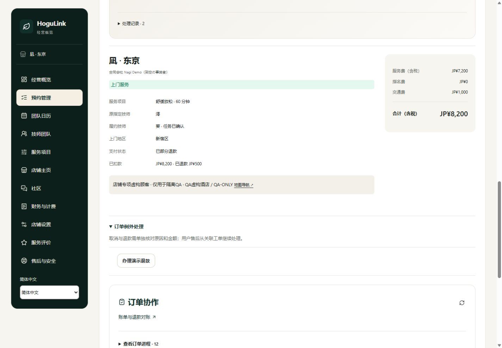

# 店铺端业务专项测试

日期：2026-11-06（日本时间）。初次测试发现两类 P2 问题；**同日后续均已修复并通过 PC/H5 验证，当前状态见 [店铺端业务修复记录](MERCHANT_BUSINESS_FIXES_2026-11-06.md)。** 下文保留修复前的复现、源码行号及截图，“尚未修复”指初次审查时点。

## 结果概览

| 优先级 | 问题                         | 实测结果                                                                                                                     | 影响                                                                         |
| ------ | ---------------------------- | ---------------------------------------------------------------------------------------------------------------------------- | ---------------------------------------------------------------------------- |
| P2     | 经营概览未把安全升级纳入待办 | 同页上方已有“已升级跟进／安全签到超时”，概览仍写“当前没有需要你处理的订单”“0 售后与安全”；仍在服务的超时订单也不在概览预约区 | 汇总引导与真实安全事项矛盾，可能漏跟进；顶部安全卡片仍可访问订单，订单未丢失 |
| P2     | 店铺审批依赖设备时间         | 服务端约 12:31 时，14:30 的休息申请仍有效；设备约 16:44，页面禁用“批准”，同一记录通过店铺接口可成功批准                      | 设备时间偏差会错误阻止合法审批；日历默认日期、安排和待机展示也仍取设备时间   |

没有把单纯的配色、排版或可优化文案列为业务缺陷。未在本轮已测场景中发现跨店越权、重复扣款、超额退款或改派免指名费计算错误；不据此断言所有生产场景均无问题。

## 测试版本、方法与范围

- 工作区：`F:\HoguLink`，分支 `main`，基准提交 `4fa74df9b809afc9f28058868508fa6b6560a433`；包含现有未提交的个人中心、技师修复、弹窗和店铺界面改动，并非该提交的干净版本。
- 独立网页 `qa.localhost:3126`、独立 API `127.0.0.1:4126`，一次性内存库。主预览 `3000/4000` 未用于测试写单。
- PC 1440 × 1000、H5 390 × 844。浏览器实际完成店铺登录、团队日历检查、概览检查、受理预约、提议改派和部分退款；顾客同意、技师回应和履约通过同一隔离 API 模拟。
- 为复现“仍在服务但已超过计划结束时间”，测试 API 从设备时间前 6 小时启动，经正常报价、保留、支付保障、技师确认和开始服务，再把测试时钟推进至设备实际时间。没有修改电脑系统时间，也没有直接把订单状态伪改成服务中。
- 请假时钟问题在推进到实际时间前验证：页面按钮禁用后，使用同一店铺账号调用审批接口并得到 `APPROVED`；之后该测试时钟只向前推进。
- 支付为模拟；姓名、地址、酒店、申请均为虚构资料。没有真实扣退款、外部邮件或应急联络。

## 正常业务核验

| 领域                 | 本轮结果与证据类型                                                                                                      |
| -------------------- | ----------------------------------------------------------------------------------------------------------------------- |
| 店铺受理与拒单后安排 | H5 实际受理澪的指名订单；澪通过接口拒绝后，H5 可提议葵接替                                                              |
| 顾客明确同意改派     | 店铺不能代顾客同意；候选不能在同意前确认。顾客明确同意后，葵仍须重新确认任务                                            |
| 改派价格             | 原价 ¥8,700；改派免原指名费 ¥500，冻结总价变为 ¥8,200，原指定人和实际履约人分别保留                                     |
| 暂停新单与存量       | 暂停新单没有取消已确认预约；重新开放后存量履约继续。新单准入、版本与店铺隔离另由全量 HTTP 用例覆盖                      |
| 履约与验收           | 服务中店铺直接取消被拒绝；未足时提交结束被拒绝；店铺不能代顾客确认完成。足时结束待验收时扣款为 0，顾客确认后实扣 ¥8,200 |
| 部分退款             | H5 实际退款 ¥500，PC 显示“已扣款 ¥8,200 · 已退款 ¥500”，剩余可退 ¥7,700                                                 |
| 退款权限与重试边界   | 超过余额、旧版本、异店退款和顾客直接调用店铺退款均被拒绝；拒绝后原订单完全不变                                          |
| 财务与复购           | 同店复购费率减半；本单平台费 ¥360，退款按比例冲回 ¥21，净平台费 ¥339。工作台实扣、已退、净额及费用条目相互一致          |
| 角色数据范围         | 顾客读到本人扣退款；技师响应继续隐藏扣退款金额、平台费和支付内部标识                                                    |
| 项目、排班与店铺主页 | 自动回归覆盖定价冻结、项目审核／停用、排班冲突、请假审批、门店资源、店铺主页草稿与发布隔离                              |
| 年度方案、开票与账单 | 自动回归覆盖试用、年度开票、支付失败、账单修订、退款冲回和店铺争议；未改动既定收费规则                                  |

本次两笔页面关联订单合计实扣 ¥16,900、退款 ¥500、净额 ¥16,400；平台费净额 ¥1,109；扣平台费后 ¥15,291。它们是本地测试账务事实，不是营收预测或真实 PSP 入账。

## 自动检查

| 检查                | 结果                                                                                           |
| ------------------- | ---------------------------------------------------------------------------------------------- |
| 全量后端测试        | 814 / 814 通过                                                                                 |
| 全量前端模型测试    | 184 / 184 通过                                                                                 |
| 隔离业务 HTTP / SSR | 20 组、2,125 项检查通过                                                                        |
| 本次补充操作        | 23 个具名场景组的结果保存在 `flow-result.json`；它们不等于 23 次人工点击，也未与上述断言数相加 |

20 组回归包含基础预约、售后与安全、店铺、技师、平台、处理分派、员工、评价、互动、顾客流程、协作、治理、财务、年度方案、开票、报表、完成验收、到店、H5 三语和店铺主页。原有自动测试通过，但没有覆盖下述店铺概览和设备时间组合，因此不能据此忽略新发现的问题。

## Issue Title：经营概览安全事项已升级，仍提示无待办（P2）

### 问题描述

【店铺端·经营概览】安全签到已经升级并要求店铺记录联系结果时，概览仍提示“当前没有需要你处理的订单”，且“售后与安全”为 0。超时未结束的服务也不再进入概览预约区，应统一按真实活动订单和未结安全事项汇总，避免与顶部安全警报矛盾。

### 前置条件

- 登录凪店铺的演示经营账号；有一笔已经实际开始但尚未提交结束的订单。
- 超过计划服务结束时间以及安全签到升级时点，尚未处理该安全事项；没有其他待处理预约、工单或请假。
- 本例订单尾号 `19B42949`，预约 2026-11-06 12:30–13:30 JST；设备与服务端约 16:44，订单仍为 `IN_SERVICE`。

### 复现步骤

1. 顾客正常提交上门预约；获派技师确认，并依次记录出发、到达和开始服务。
2. 在隔离测试环境推进服务端时钟，超过原计划结束时间及签到升级时点，保持服务未提交结束。
3. 以所属店铺账号打开【经营概览】，路由 `/{locale}/merchant?tab=overview`。
4. 等待页面及安全区读取完成。
5. 查看上方【履约安全签到】，确认显示“已升级跟进”“安全签到超时”和“记录联系结果”按钮。
6. 查看【今日工作台】，确认出现“当前没有需要你处理的订单”，【售后与安全】为 0。
7. 查看【接下来的预约】，显示“当前没有符合条件的预约”；通过安全卡片【查看关联预约】或【预约管理】仍可找到该订单。

### 期望结果

未处理的安全升级应反映在概览的待办判断和安全数量中；仍在履约的超时任务应有明确入口和状态提示。普通“未来预约”可独立展示，但不能用其计划时间推断服务已结束。

### 实际结果

顶部安全警报存在，概览待办和安全数却为 0，仍在服务的订单从概览预约区过滤。**并非整站无法找到订单**：安全卡片、团队日历及预约管理仍提供入口。

### 根因分析（源码）

- 项目／分支：HoguLink，`main` 当前工作区。
- 页面／路由：`/{locale}/merchant?tab=overview`，经营概览。
- 触发条件：订单 `IN_SERVICE` 且超过 `quote.endAt`，存在未处理的升级签到／安全记录，但无普通待处理工单。
- 实际执行链：工作台读取订单和工单 → `merchantWorkday(bookings)` 汇总普通订单待办 → `openCases` 仅统计工单 → `hasWork` 为 false；独立 `SafetyDeskPanel` 同时读到真实安全升级。
- 代码证据：`merchant-workspace.tsx:256` 的预约过滤只保留 `quote.endAt > Date.now()`；`:259` 的 `openCases` 只读 `tickets`；`:261` 的 `hasWork` 未包含安全事项。`workday-model.ts` 的 `merchantWorkday()` 及 `desktop-model.ts` 的 `needsAttention()` 不会把普通服务中订单或独立安全升级纳入此处计数。
- 根本原因：安全面板和概览待办使用不同数据来源，安全状态没有进入汇总；预约区又依赖计划结束时间。
- 影响范围：店铺 PC/H5 共用的概览。截图及 API 同时证实记录存在而汇总未计入。
- 定位结论：已确认根因。
- 建议修复点：以服务端返回的未结安全数量和活动履约事实构建概览摘要，统一标题、角标及入口；补超时服务、升级后已联系但未结案等组合测试。

### 复现频率、影响及严重程度

- 复现频率：上述条件下必现。
- 功能模块：经营概览、履约安全摘要。
- 用户范围：遇到超时履约或升级签到的店铺经营账号。
- 是否阻塞主流程：不阻塞接单或付款；顶部安全卡片可作为处理入口，但汇总引导错误。
- 是否影响上线：建议上线前修复，避免经营人员依据错误待办汇总判断。
- 严重程度：P2 Major。

### 测试环境与附件

- 环境／版本：本地独立内存库，版本及分支见报告开头。
- 浏览器／设备：Codex 内置浏览器，PC 1440 × 1000；H5 390 × 844 读取同一概览亦见相同矛盾。
- 账号：演示店铺 `store-nagi`；虚构顾客及技师葵。
- 接口／服务：`GET /v1/bookings`、`GET /v1/merchant/workspace`、履约安全摘要。
- 截图：`02-pc-overrun-missing.png`，完整页面保留了顶部安全警报和下方空摘要。
- 录屏：未录制。
- 日志／返回结果：`edge-case-results.json` 的 `overrun`；自动日志见证据目录。

### Summary

经营概览，P2，指定超时与安全升级组合下必现；待办汇总与实际安全事项不一致，尚未修复。

## Issue Title：设备时间偏快会禁用仍可批准的休息申请（P2）

### 问题描述

【店铺端·团队日历】休息申请尚未到服务端开始时间时，设备时钟偏快会让“批准”按钮错误禁用。同一账号和同一申请通过正常审批接口能成功批准，页面应统一使用服务端时间判断资格。

### 前置条件

- 登录店铺 `store-nagi`，技师澪有一笔无预约冲突的 `PENDING` 休息申请。
- 服务端约 12:31 JST，申请时间 14:30–15:30；设备约 16:44。差异通过独立测试服务的时钟构造，没有改系统时间。

### 复现步骤

1. 在隔离环境以技师澪提交 14:30–15:30 的短时休息申请。
2. 以店铺账号打开【团队日历】，路由 `/{locale}/merchant?tab=schedule`。
3. 等待【休息申请记录】显示“澪 · 短时休息”和对应时间。
4. 查看该行【批准】按钮，按钮灰显，不能点击；【不批准】仍可点击。
5. 保持申请及账号不变，以店铺身份调用正常 `PUT /v1/merchant/time-off-requests/{id}`，提交 `{version:1, decision:"APPROVED"}`。
6. 核对返回 `APPROVED`，证明服务端确认申请未过期且无冲突。

### 期望结果

服务端仍允许批准时，页面应允许经营者发起审批；到达过期时间后按服务端现状刷新并禁用。倒计时、默认日历日期和时间判断应共用服务端锚点。

### 实际结果

页面认为申请已经过期而禁用批准；同一申请接口批准成功。本例状态没有被页面改成过期，问题是合法操作被前端提前拦截。

### 根因分析（源码）

- 项目／分支：HoguLink，`main` 当前工作区。
- 页面／路由：`/{locale}/merchant?tab=schedule`，团队日历 → 休息申请记录。
- 触发条件：`serverNow < request.startAt <= Date.now()`。
- 实际执行链：店铺工作台读取休息申请 → 审批行以本机 `Date.now()` 判断 `disabled` → 无法发送本来合法的审批请求；服务端 `StaffService.review()` 按 `this.now()` 和实际冲突检查允许批准。
- 代码证据：`merchant-workspace.tsx:714` 为 `disabled={busy || r.startAt <= Date.now()}`；`:142` 的默认日期、`:256` 的预约筛选同样使用设备时间。`merchant.ts` 的工作台快照尚未提供统一 `serverNow`，没有复用已修复技师端的服务端计时方案。
- 根本原因：前端操作门槛使用设备墙上时间，服务端资格使用服务端时间，两者存在偏差时判断不一致。
- 影响范围：店铺审批及同一工作台的日期、安排与待机时效展示；本次直接复现的是 PC 审批禁用，不把其余展示影响冒充逐项手工复现。
- 定位结论：审批问题已确认根因；其他同源时间展示为源码确认的影响点。
- 建议修复点：店铺工作台返回 `serverNow`，采用服务端锚点加单调经过时间；审批及相关日历／等待判断共用该时间，增加快两分钟、跨日与重新聚焦校时测试。

### 复现频率、影响及严重程度

- 复现频率：上述时钟关系下必现。
- 功能模块：店铺团队日历、休息审批。
- 用户范围：设备时间偏快且申请接近开始时间的经营者。
- 是否阻塞主流程：会阻塞页面上的合法批准，可校准设备时间或待代码修复；不涉及越权批准或重复扣款。
- 是否影响上线：建议上线前修复，统一店铺与技师时钟口径。
- 严重程度：P2 Major。

### 测试环境与附件

- 环境／版本：本地独立内存库，版本及分支见报告开头。
- 浏览器／设备：Codex 内置浏览器，PC 1440 × 1000。
- 账号：演示店铺 `store-nagi`、技师 `staff-mio`。
- 接口／服务：店铺工作台、技师请假与店铺审批接口。
- 截图：`01-pc-leave-disabled.png`。
- 录屏：未录制。
- 日志／返回结果：`edge-case-results.json` 的 `clock`，含服务端时间、设备时间、申请开始时间及批准结果。

### Summary

店铺休息审批，P2，指定时钟偏差条件下必现；前端错误禁用服务端仍允许的批准，尚未修复。

## 证据与结束状态

证据位于 `docs/qa-assets/merchant-audit-20261106/`：`backend.log`、`model.log`、`smoke.log`、`edge-case-results.json`、`flow-result.json` 和五张截图。启动凭据、会话和一次性脚本只留在本地忽略目录 `.qa/merchant-audit-20261106/`，不放进报告附件。

本次只新增报告和测试证据，保留全部既有业务源码改动。测试网页/API 已结束，主站保持运行；没有提交、推送或部署。真实支付服务商、正式通知和生产数据库并发不属于本地模拟通过所能证明的范围。
