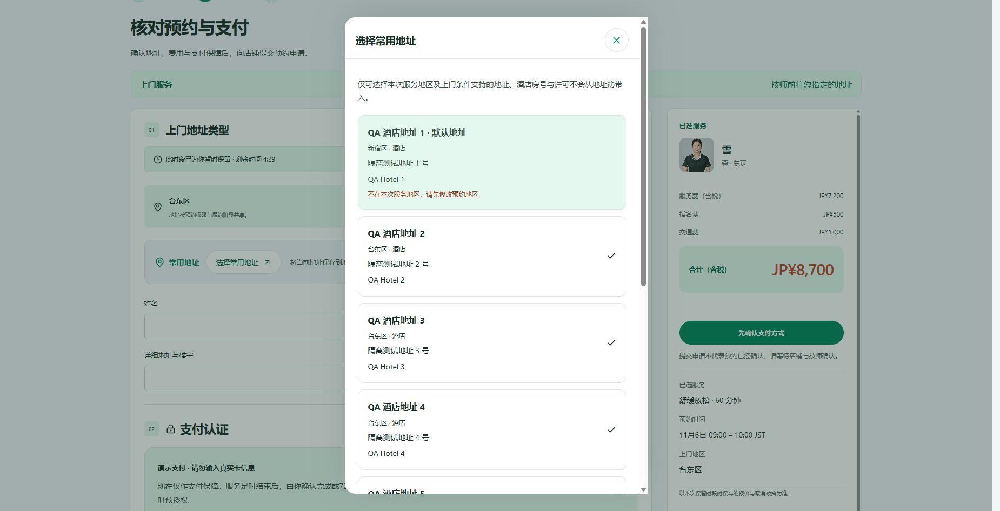
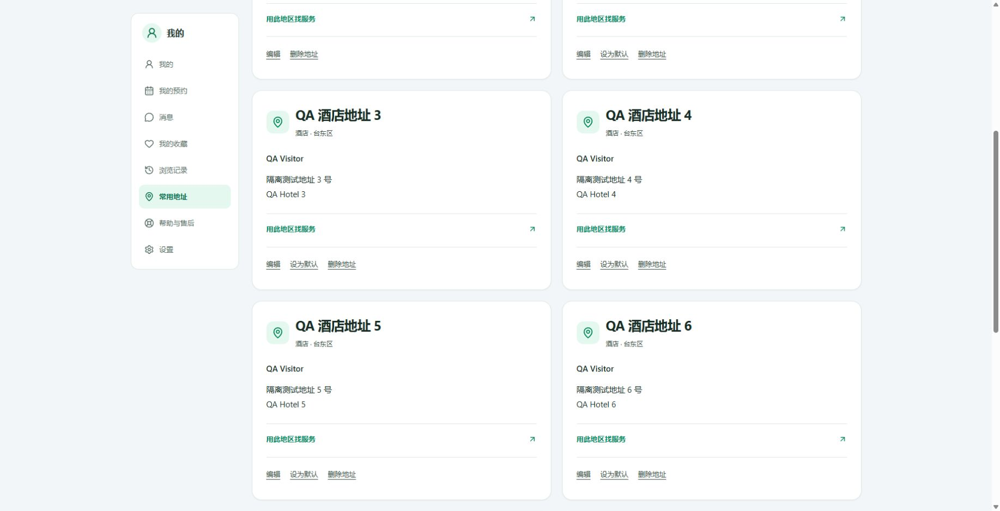
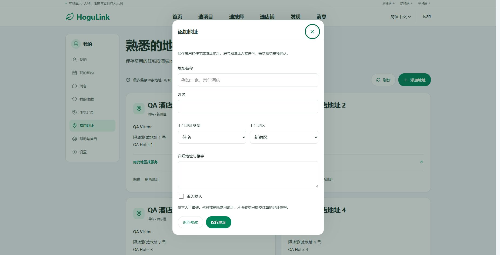
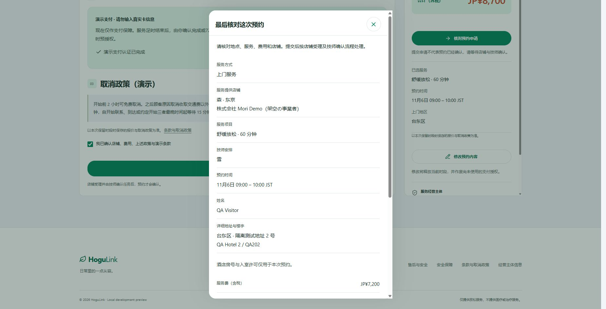
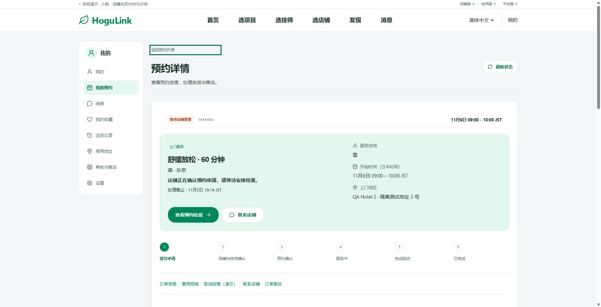
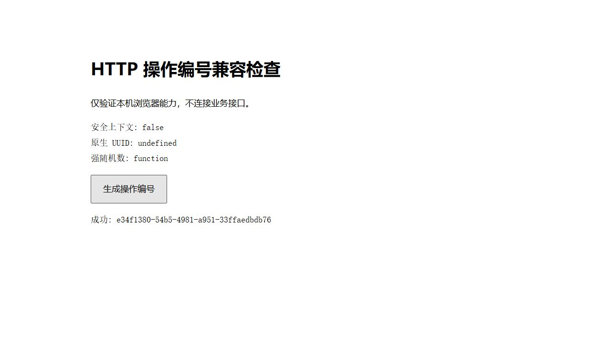
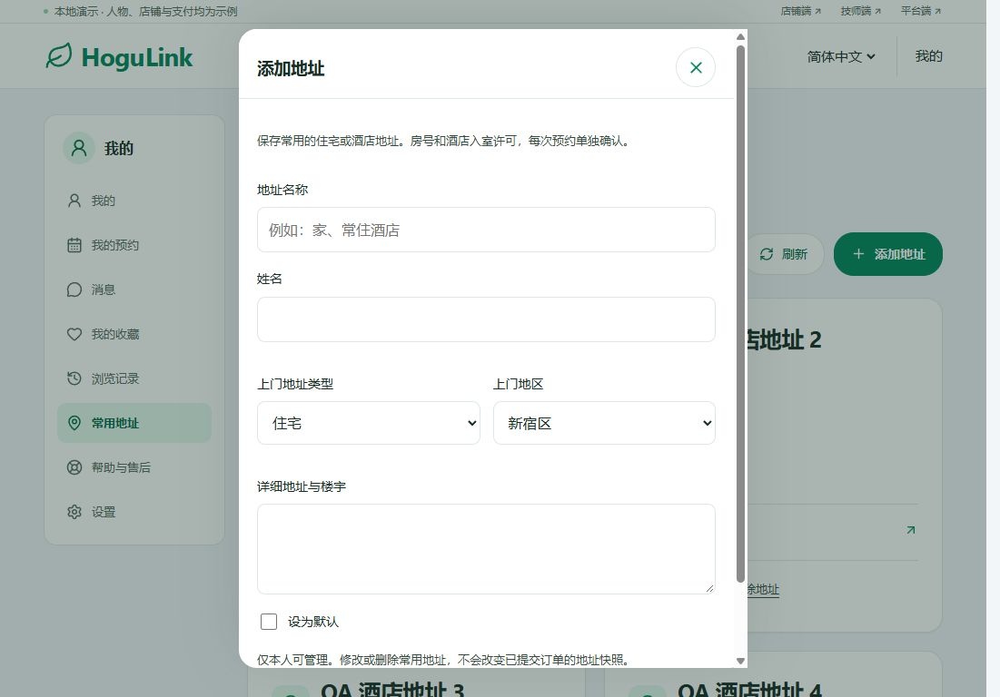
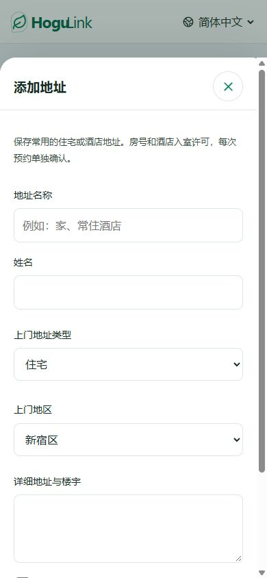

# PC 弹窗、页面滚动与预约提交修复记录

日期：2026-11-05（日本时间）
基线：`4fa74df9b809afc9f28058868508fa6b6560a433`
状态：本地修复与验证完成，尚未提交、推送或部署。

用户报告：常用地址弹窗在 PC 上偏下、其他页面无法下拉；点击“核对／提交预约”持续提示“操作未完成，请重试”。

## 结论与原因

| 问题 | 原因与证据 | 修复 |
| --- | --- | --- |
| PC 弹窗没有居中 | 共用 `.mobile-sheet` 仅定义了手机底部抽屉。1850×946 下，修复前弹窗 top=437.3、bottom=946。 | 1101px 以上普通弹窗改为水平、垂直居中，限制可见高度；保留手机底部抽屉和管理端侧栏。 |
| 关闭弹窗或切换页面后可能无法下拉 | `MobileSheet` 保存并恢复 body 的旧 overflow 值。多个弹窗重叠或卸载顺序变化时，可以把旧的 hidden 恢复回去。 | 移除手动 body 锁定，改为依据 DOM 中实际打开的 dialog 控制根页面滚动。关闭最后一个弹窗或离开页面后自动解除。 |
| 提交预约出现通用错误 | 用户实际访问公网 HTTP。线上页面引用的 `3prhj1tx-o-s7.js` 中，提交预约在 POST 前直接调用 `crypto.randomUUID()`；不支持时异常被通用错误提示掩盖。 | 使用共用 `newRequestKey()`：优先原生 UUID；不可用时用 `crypto.getRandomValues()` 生成 UUID v4。保留原有重试编号复用机制。相同调用的 16 个客户端组件同步修复。 |

浏览器原生 `randomUUID()` 仅在安全上下文可用；`getRandomValues()` 可用于非安全上下文，仍提供加密强随机数。来源：[MDN randomUUID](https://developer.mozilla.org/en-US/docs/Web/API/Crypto/randomUUID)、[MDN getRandomValues](https://developer.mozilla.org/en-US/docs/Web/API/Crypto/getRandomValues)。服务器端 nonce 生成没有改动。

线上页面只做只读检查，没有替用户提交预约、支付或修改个人资料。检查时该页面的时段保留已经过期；更新后需重新选择可约时段。

## 测试环境

- 浏览器：当前审查期间新抓取的真实页面截图；PC 1850×946、临界 PC 1101×768、手机 390×844。
- 隔离演示站：Web `localhost:3115`，API `127.0.0.1:4115`，内存测试数据、邮件关闭、后台任务关闭。
- 地址、姓名、房号均为虚构 QA 数据；只在隔离环境提交了一笔模拟预约。原有 3000/4000 服务及其数据没有修改。
- HTTP 兼容性：使用本机私网 IP 的临时 HTTP 诊断页加载同一份编号生成函数；页面实际脚本显示 `isSecureContext=false`、`randomUUID=undefined`、`getRandomValues=function`，生成编号成功。该诊断页及隔离测试服务已关闭。

## 逐步验证

### 1. 打开常用地址并选择兼容地址：通过

1850×946 下长列表弹窗上下各留 32px，列表在弹窗内部滚动；键盘定位第 8 个地址时，弹窗 scrollTop 增加而背景页面位置不变。不兼容地区地址禁用，兼容地址可选择并回填。

修复前普通项目弹窗贴底：

修复后同一项目弹窗居中：

结算页长地址列表居中并内部滚动：

### 2. 关闭弹窗、从弹窗切换页面并下拉：通过

- Escape 关闭及关闭按钮关闭后：打开的 dialog 数量为 0，body 没有遗留 inline overflow，根页面 overflow 恢复 visible。
- 在结算地址弹窗打开时点击“常用地址 ↗”离开结算页：新页面 dialog 数量为 0；PageDown 后滚动到约 805px。
- 模拟预约提交跳转后，订单页也可继续向下滚动。

原用户页面已经处于关闭弹窗状态，未捕获当时卡住的瞬间；本次确认并移除了代码中的旧滚动锁恢复机制，以上场景是在隔离环境实测。

新增地址表单在大屏完整居中，底部保存和返回按钮可见：

### 3. 核对并提交预约：通过（模拟支付）

选择兼容酒店地址，填写虚构房号，通过演示支付认证，打开核对弹窗并提交，成功进入“等待店铺确认”订单页。

- 测试单：`booking_4c8b62d7-0c56-4311-80cc-d8870aaa8eb3`
- 服务：雪／森·东京，舒缓放松 60 分钟，2026-11-06 09:00–10:00 JST。
- 合计：JP¥8,700（7,200 + 指名 500 + 交通 1,000）。
- 仅为演示授权，没有真实扣款。

另外在真实非安全 HTTP 上验证编号兼容分支，生成 UUID v4 成功：

## 响应式与自动检查

| 检查 | 结果 |
| --- | --- |
| 1101×768 PC 临界宽度 | 弹窗宽 560px，top=32、bottom=736，内容可滚动，无横向溢出。 |
| 390×844 手机 | 保留底部抽屉，bottom=844；关闭后恢复滚动，无横向溢出。 |
| 前端测试 `npm run test:desktop` | 181/181 通过，包含新增的原生 UUID、HTTP 兼容、UUID 格式及唯一性检查。 |
| `npm run build` | 通过，全工作区类型检查与 Web 生产构建成功。 |
| `git diff --check` | 通过。 |

运行日志保留在忽略目录 `.qa/modal-scroll-20261105/models.log` 与 `build.log`。

## 范围与限制

- 本次验证覆盖相关弹窗、关闭与路由切换后的滚动、模拟预约提交，以及 HTTP 编号兼容；不是全站再次完整验收。
- 键盘打开／关闭、长列表焦点可达性与滚动已实测；未做完整读屏、浏览器矩阵或 WCAG 合规审计。
- 未验证真实支付渠道，也没有在公网旧版本上代用户下单。
- 线上站点需部署本次修复才能生效。原过期保留单不能继续提交，需要重新选时段。
