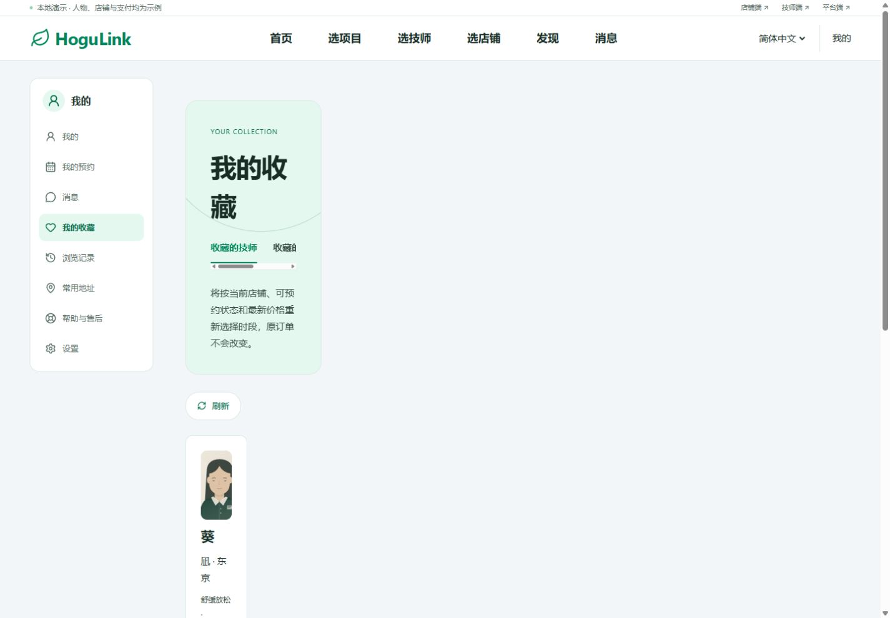
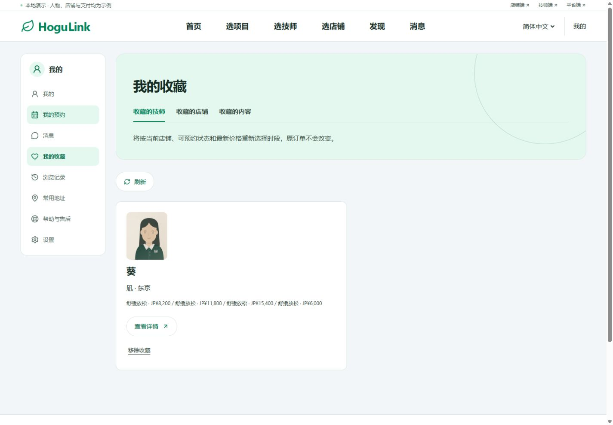
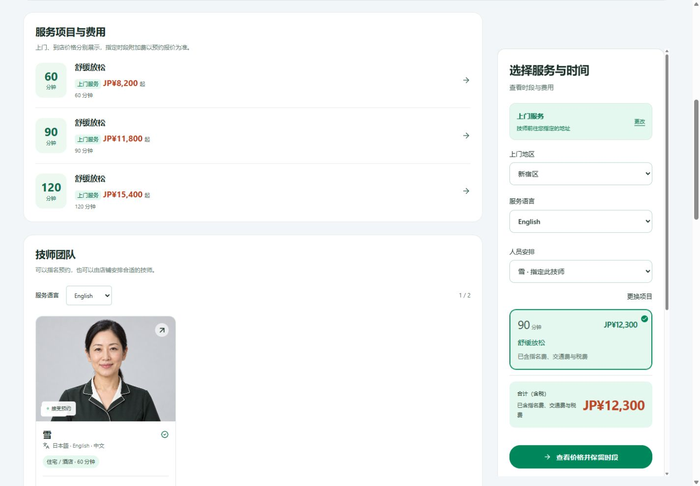
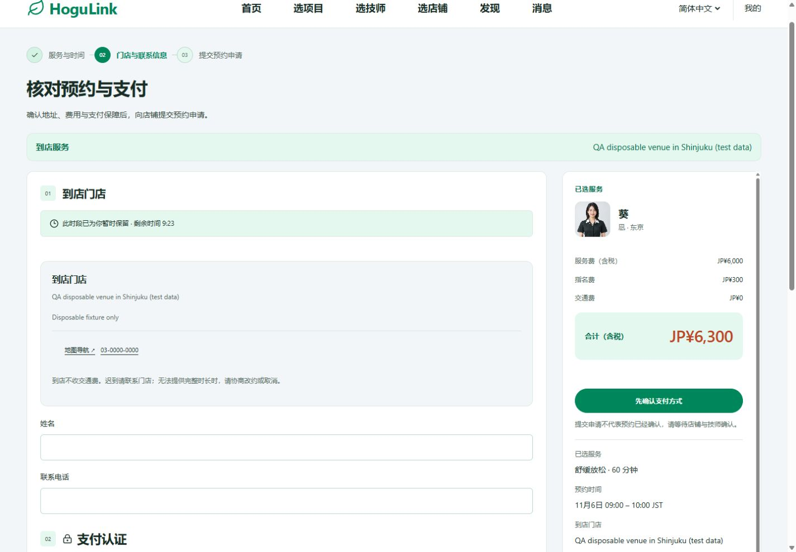

# PC 用户端全面测试与修复报告

日期：2026-11-05（日本时间）

代码基线：`3efa1da24b5a37982bce26754b9e111b75ea2d32`（main）

结果：核心演示预约链路通过；本轮发现并修复 7 项功能或布局缺陷，修复已回归。本报告与修复代码、回归用例一并归档，交付状态以 Git 提交记录为准。

## 1. 测试方式与环境

- 浏览器实际操作：ChatGPT in-app browser 的 Chromium 内核，本地 Windows。不是 Chrome、Edge、Safari、Firefox 全浏览器兼容性认证。
- 主测视口：1440×1000；补测 1101×900、1280×900、1920×1080；390×844 只做共享预约页的 H5 回归。
- 中文走完整流程；英文、日文检查首页和语言切换，英文另检查 1101px 收藏页。三语言 SSR 由自动检查补充，不代表每个交互都逐语言重跑。
- 隔离网页：`http://localhost:3115`；隔离 API：`http://127.0.0.1:4115`，仅本机监听、内存数据库、演示支付、邮件关闭、后台任务关闭。
- 使用 `localhost` 隔离账号 Cookie，避免与原站 `127.0.0.1:3000` 共用；不向原 SQLite 写测试订单，不联系真实店铺、顾客或邮件收件人。
- 到店服务在隔离 API 中配置虚构门店、技师资格和审核通过的菜单后测试。初始样例菜单 9 个、技师 6 位、店铺 3 家；与原站已经编辑过的样例数据数量不同属于预期。
- 测试结束关闭隔离标签页、恢复视口并停止本轮两个隔离服务；原 3000 / 4000 服务保留。恢复 Next 自动产生的配置变动。

自动审批曾以“blocked by policy”拒绝独立生产预览的启动，浏览器改用隔离开发预览；生产构建本身通过。本文不把开发预览操作等同于生产服务器上的交互验收。独立 API 的后台启动也曾受限，改用受监督的前台测试进程后完成隔离。

## 2. 自动验证结果

| 检查                              | 本轮结果                | 说明                                                                   |
| --------------------------------- | ----------------------- | ---------------------------------------------------------------------- |
| `npm run check`，修复前基线       | 通过                    | API 803 项、前端模型 176 项、媒体 5 项；工作区类型检查及生产构建通过   |
| 独立 QA 构建                      | 通过                    | `.next-h5-qa`，指向隔离 API                                            |
| `node scripts/smoke-isolated.mjs` | 20 组、2,078 个断言通过 | HTTP、SSR 及依赖业务流程；写操作使用脚本各自的内存 API                 |
| `smoke-accounts`                  | 37 项通过               | 本地邮件接收器验证注册、验证邮件、登录、密码恢复等；没有真实邮件投递   |
| 修复后 `npm run test:desktop`     | **178 / 178 通过**      | 新增“显式人员安排优先于店铺默认”和“首页日期搜索返回保留条件”的回归用例 |
| 修复后 `npm run build`            | **通过**                | 全工作区类型检查、Next 生产构建通过                                    |
| `git diff --check`                | 通过                    | 无空白错误                                                             |

20 组隔离流程涵盖：基础预约、售后、商户、技师、平台、工单处理、员工权限、评价收藏、发现与消息、地址与恢复、协调改派、治理、财务、订阅、开票、报表、完成验收、到店履约、H5 契约与三语言 SSR、店铺主页。不同检查有业务重叠，以上数量不相加作为独立场景总数。

原始日志：本地 `.qa/pc-comprehensive-20261105/` 中的 `check.log`、`isolated-build.log`、`isolated-smoke.log`、`accounts.log`、`retest-models.log`、`retest-build.log`。这些运行产物在 Git 忽略目录中，不随报告提交。

## 3. 浏览器实测矩阵

以下均为本轮实际执行。截图编号对应 `.qa/pc-comprehensive-20261105/`，没有截图的补充结果以 DOM、URL、表单反馈或自动检查为依据。

| 编号  | 操作步骤与验证点                                                                  | 最终结果 / 证据                                                                            |
| ----- | --------------------------------------------------------------------------------- | ------------------------------------------------------------------------------------------ |
| PC-01 | 首页识别业务；检查六项顶部导航、“首页”选中态、“全部项目”位于精选服务标题右侧      | 通过，01、65                                                                               |
| PC-02 | 首页项目 / 技师 / 店铺切换，刷新保持维度，方向键切换页签                          | 通过，02、03                                                                               |
| PC-03 | 首页选择服务方式、地区、日期、时长，查找可约                                      | 条件传至高级目录；返回详情后日期不丢，39、57                                               |
| PC-04 | 项目目录搜索“森”，选择 90 分钟，打开“预约此项目”                                  | 结果收敛为对应菜单；弹窗展示方式、指定与店铺安排两种费用，58、59                           |
| PC-05 | 项目弹窗主动选择上门，再选择店铺安排                                              | 进入完整预约页，保留项目、语言、地区、FREE；回列表保留搜索和时长，60                       |
| PC-06 | 技师目录查看起价明细，Esc 关闭弹窗                                                | 服务 7,200＋指名 500＋交通 1,000＝8,700；关闭后焦点返回原按钮，29                          |
| PC-07 | 店铺目录搜索、地区、排序、方式与语言筛选；输入新关键词后直接换筛选                | 修复后保留输入值；正确显示结果 / 空结果，08、09、47                                        |
| PC-08 | 从有关键词、地区、语言和排序的店铺列表进入详情，再点面包屑返回                    | 修复后返回原店铺列表与条件，50 及返回 URL                                                  |
| PC-09 | 技师详情图片放大，Esc 退出，收藏技师                                              | 图片可查看；焦点回照片按钮；账号收藏同步，30、31、32                                       |
| PC-10 | 店铺预约切换指定 / 不指定、60 / 90 分钟、日期和时刻                               | 金额、人员和时长一致；紧凑项目卡宽度修复，11、12、40、50                                   |
| PC-11 | 登录空提交、错误账号密码；注册空姓名、错误邮箱、短密码及未选条款                  | 提示明确、阻止提交、焦点落到首个错误字段，14～16                                           |
| PC-12 | 未登录时指定雪、90 分钟、11/6 09:00；登录返回，再刷新                             | 修复后始终 NOMINATED、90 分钟、12,300；不是登录后自动改为店铺安排，48～50                  |
| PC-13 | 保留时段进入上门结算，核对报价及期限                                              | 报价冻结，10,800＋500＋1,000＝12,300，18                                                   |
| PC-14 | 模拟支付认证失败，使用恢复入口重新选择                                            | 保留释放，旧结算不可提交；返回保留人员、项目、时刻等选择，19                               |
| PC-15 | 酒店订单未填姓名、地址、酒店、房号及入店同意时核对申请；补齐后核对                | 原生必填校验阻止遗漏；最终核对显示完整虚构资料与 12,300，20、21                            |
| PC-16 | 提交模拟预约，查看订单，预览取消费用，再确认取消                                  | 显示等待店铺受理，未误报已确认；提前取消为 0；列表显示已取消，22、24、25                   |
| PC-17 | 在订单内发送隔离测试留言，消息中心查看预约动态并标为已读                          | 留言只进内存环境；已读数从 1 变为 0，23、34                                                |
| PC-18 | 常用地址新建酒店地址、默认标记、改名、保存、删除                                  | 地址列表同步；不保存房号与酒店入店同意，26、27                                             |
| PC-19 | 收藏技师与内容，检查历史；退出登录后查看历史空状态                                | 收藏可读取；历史记录出现；退出后本机历史清空；“浏览技师”正确到技师目录，32、33、45、46、63 |
| PC-20 | 售后空提交，再关联已取消订单并提交虚构问题                                        | 必填校验通过后生成工单，显示等待店铺处理、目标回复时间及原订单链接，35、36                 |
| PC-21 | 发现推荐、问答空状态、指南分类、内容详情，切换图片，收藏内容                      | 分类与详情可用；图片序号更新；内容收藏可在账号读取，37、38                                 |
| PC-22 | 到店筛选 → 技师 → 主动选择到店 → 选时 → 结算 → 模拟支付保障 → 最终核对 → 修改预约 | 费用 6,000＋300＝6,300，交通 0；不要求顾客住宅 / 酒店资料；修改释放保留，39～42            |
| PC-23 | 120 分钟＋10,000 预算制造无结果，再返回                                           | 0 结果明确显示；条件可调整，返回恢复 60 分钟条件，56、57                                   |
| PC-24 | 在内存 API 注入订单消息和售后读取 503，之后解除并点击重试                         | 显示失败而非伪空白；重试恢复已有留言和售后，订单状态未受影响，43、44                       |
| PC-25 | 从设置访问隐私说明；访问不存在的技师                                              | 隐私说明可读；无效资料显示 404，无应用崩溃；404 本地化有待优化，64                         |
| PC-26 | 中 / 日 / 英切换；1101 / 1280 / 1440 / 1920 桌面；390 预约页回归；跳至正文        | 测试视图无整页横向溢出；语言与内容切换成功；锚点可用，51～55、61～65                       |

共保存 65 个截图状态；13 号属于导航尚未完成的中间页，已剔除，接受 64 个。接受的状态检查未发现整页横向溢出、重复 ID、已加载可见图片损坏或可见表单控件缺少名称。该轻量检查不等于所有图片均已加载，也不代替读屏和完整无障碍审查。

浏览器捕获日志未出现应用 JavaScript 异常；记录的两条警告均是改代码时开发预览进行完整热刷新。主动注入的 503 和无效资料 404 不作为意外服务故障。

## 4. 发现并修复的 7 项缺陷

| 缺陷                             | 优先级 | 修复前复现与影响                                                                        | 根因与修复                                                                                                                          | 回归                                                                    |
| -------------------------------- | ------ | --------------------------------------------------------------------------------------- | ----------------------------------------------------------------------------------------------------------------------------------- | ----------------------------------------------------------------------- |
| B01 登录 / 刷新覆盖顾客人员选择  | P1     | 店铺页选择指定雪、90 分钟，登录返回后自动 FREE，12,300 变 11,800                        | `booking-form.tsx` 用“URL 为 FREE 或店铺默认 FREE”初始化，显式 NOMINATED 无法覆盖默认。新增 `selectedNomination`，合法 URL 选择优先 | 登录往返、刷新、金额及模型用例通过，48～50                              |
| B02 店铺筛选覆盖输入中的关键词   | P2     | 搜索森后输入凪，直接改地区 / 排序时新词丢失，结果不符合输入                             | `shop-directory.tsx` 路由合并旧 q，组件重建恢复旧词。所有提交统一带当前 search，重置分页                                            | 地区、排序、筛选弹窗组合通过，47                                        |
| B03 PC 预约项目摘要被挤窄        | P2     | 详情侧栏的“更换项目”和单个摘要占旧三列布局，单卡约 90px，金额和说明竖排                 | PC 最终样式将紧凑项目选择改为全宽摘要；更换按钮独立一行，时长和价格同排                                                             | 40、48、50；完整预约页 61 与 H5 62 回归                                 |
| B04 详情面包屑返回错误业务维度   | P2     | 从店铺列表进入却显示“寻找技师”，点后跳技师列表，丢店铺条件                              | `DetailBreadcrumb` 硬编码技师目录。复用 `BrowseReturnLink`，传入来源并给店铺提供 shops 回退                                         | 店铺列表 search / area / language / sort 恢复；技师返回高级目录通过     |
| B05 收藏页被旧内层侧栏挤成窄列   | P2     | 外层已有账号导航，内层导航隐藏后还保留 220px 网格；内容落进第一列，标题和卡片严重折行   | 在 ≥1101px 重置账号内 `quality-shell` 为整列宽度，标题统一为 32px                                                                   | 1440 中文、1101 英文通过；主内容恢复为 1105px，单收藏卡 542.5px，45、63 |
| B06 历史空状态入口指向首页       | P2     | 按钮写“浏览技师”，却打开默认项目首页                                                    | `DeviceHistory` 的链接改为对应语言 `/therapists`；移除历史 / 收藏中文页的装饰英文眉题                                               | 退出后空状态和实际跳转通过，46                                          |
| B07 首页日期搜索返回详情后丢日期 | P2     | 首页带 date 进入高级列表，但 URL 没有 filters=advanced；列表恢复缓存按简版规则忽略 date | `browseListQuery` 与页面高级视图判定对齐：日期 / 预算 / 受理方式 / 视图存在时保存高级条件                                           | 日期 2026-11-06 随详情返回保留；新增模型用例通过，57                    |

视觉修复限定 PC ≥1101px；状态与链接修复复用现有共享模型。不更改费率、支付归属、订单价格规则或取消规则。

主要实现：`booking-form.tsx`、`visit-model.ts`、`shop-directory.tsx`、`visit-shared.tsx`、两类详情页、`booking-browse-model.ts`、`consumer-journey.tsx`、`experience-ui.tsx`、`pc-consumer.css`。新增有业务意义的回归用例位于 `scripts/customer-pc-flow.test.ts` 和 `scripts/booking-browse-model.test.ts`。

## 5. 关键截图

### 收藏页修复前后

修复前，内容挤进旧的内层侧栏列：

修复后，主内容完整占用账号导航右侧：

### 指定人员与项目摘要

登录返回并刷新后，指定雪、90 分钟和 12,300 仍保持，项目摘要恢复全宽：

### 到店结算

门店地址明确；姓名、联系电话与上门地址分开；合计 6,300、交通 0：

### 最终首页

保留首页按钮、H5 绿色体系及“全部项目”的标题区位置：

## 6. 仍建议优化的非阻断项

1. **收藏卡价格阅读（P3）**：目前把多个菜单的基础价格串成一行，没有分别展示时长、服务方式和指名费用说明；收藏照片也与详情页的新示例肖像不同。建议按菜单分行、标明参考价格组成并统一示例图。证据 45、63；这次只修复布局，没有重做收藏价格展示。
2. **404 本地化（P3）**：三语标题下面仍是英文说明，返回按钮固定 `/ja`。中文用户可恢复浏览，但语言不连续。证据 64，源代码 `src/app/not-found.tsx`。
3. **消息页标题语义（P3）**：有一个隐藏 H1“消息”和一个可见 H1“每一步，都心中有数”。建议合并页面标题层级，另用读屏实际验证。证据 34 与 DOM，源代码 `engagement-ui.tsx`。

曾观察到从滚动较深的侧栏进入上门结算时停留在较深滚动位置；后续到店导航未出现同样遮挡，尚未形成稳定复现和根因，因此列为观察项，不计入已确认缺陷或已修复项。

## 7. 验收边界

- 已验证的是**演示支付**成功、失败、释放和恢复；未连接真实 PSP，未实刷、未实际扣款、未实际退款，不能据此认定正式支付已验收。
- 浏览器注册测试覆盖校验和邮件未配置提示；真实注册 / 邮箱验证 / 密码恢复由本地邮件接收器自动测试补充，未向真实邮件渠道投递。
- 真实设备定位授权、系统定位失败、外部地图唤起、文件上传与真实内容发布未在浏览器逐项执行；相关接口与权限由已有隔离自动检查覆盖其部分逻辑。
- 改派、履约、完成验收、评价审核、费用争议等由隔离 HTTP 流程验证；本轮没有逐一通过多角色浏览器完成每条分支。
- 没有开展真实运营数据压测、渗透测试、第三方无障碍认证或完整读屏测试。截图不能证明 WCAG 全面合规。
- 生产构建通过；生产预览启动受到自动审批策略限制，生产服务交互、跨浏览器和上线渠道联调仍需单独验收。

在上述边界内，核心用户 PC 演示流程可继续用于评审和联调；这份报告不构成正式上线许可。
