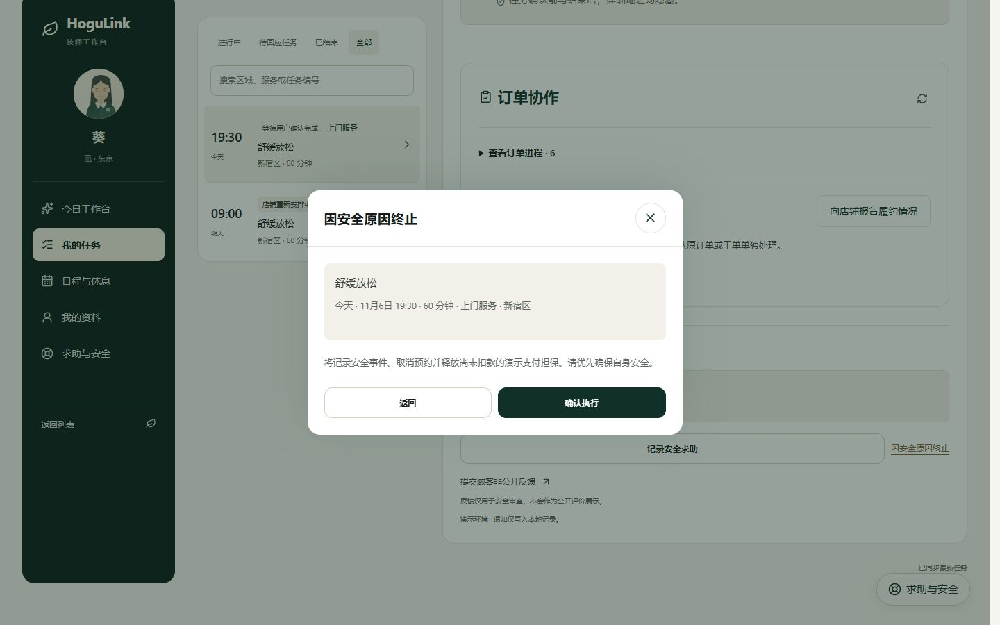
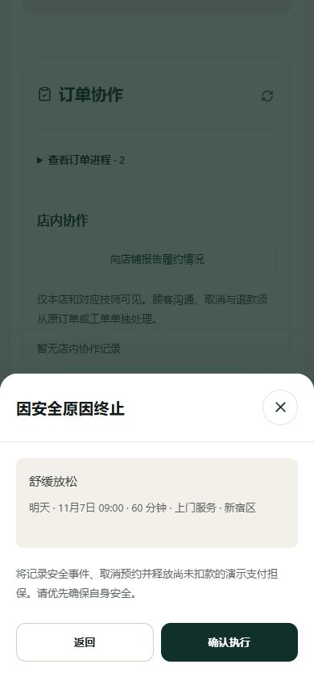

# 技师端业务专项复查

日期：2026-11-06（日本时间）。初次审查发现 3 类问题、4 个复现场景；**同日后续已完成修复与回归，当前结果见 [技师端业务修复记录](STAFF_BUSINESS_FIXES_2026-11-06.md)。** 下文保留修复前的复现过程和截图，所列代码行号及“当前”均指初次审查版本。

本次对照已定业务规则检查当前工作区，基准提交 `4fa74df9b809afc9f28058868508fa6b6560a433`，包含现有未提交改动。这不是只针对某次提交的增量审查，不将以下问题归因于最近的样式调整。

## 结论

| 优先级 | 问题                               | 复现结果                                                           | 建议                                         |
| ------ | ---------------------------------- | ------------------------------------------------------------------ | -------------------------------------------- |
| P1     | 安全终止缺少履约阶段和任务权限限制 | 足时结束待验收、已经拒单，两种情况下技师均可直接取消整单并作废授权 | 上线前修复后端权限与状态约束，并同步页面入口 |
| P2     | 技师订单接口返回退款和平台费数据   | 返回已扣款 8700、已退款 500、平台费 770，可推算退款余额 8200       | 按角色返回字段，隔离顾客售后及商户财务数据   |
| P2     | 出发操作依赖终端本地时钟           | 终端慢 2 分钟时页面禁用按钮，服务端同一时刻已允许出发              | 使用服务端时间锚点，统一倒计时和动作开放判断 |

现有技师 79 项检查、完成验收 132 项检查重新执行仍全部通过。这说明现有自动回归缺少上述异常组合；不代表这些缺陷已修复。

## 1. P1：安全终止可以绕过验收，也能由已拒单技师取消整单

代码位置：

- `hogulink-api/src/engine.ts:2984`：`safety()` 只核验技师身份、订单读取权限、版本及订单非终态。
- `hogulink-api/src/engine.ts:3002`：安全终止直接调用 `closeBooking(..., 'CANCELLED', 'SAFETY_TERMINATION')`，未限制为仍在履约的已确认任务。
- `hogulink-api/src/engine.ts:2803`：未指定费用的关闭会作废支付授权并释放占用。
- `hogulink-web/src/components/staff-workspace.tsx:833`：只要订单未进入终态就显示安全终止入口，包含待验收和技师已拒绝的任务。

### 场景 A：足时服务结束，等待顾客验收

1. 顾客下单，技师确认并依次出发、到达、开始。
2. 推进隔离测试时钟至足够购买时长，技师提交结束。
3. 核对订单为 `AWAITING_COMPLETION`，授权有效，尚未扣款。
4. 在技师任务详情点击“因安全原因终止”，再点“确认执行”。

实际：订单变为 `CANCELLED`，支付为 `VOIDED`，已扣款为 0；验收记录仍为 `PENDING`。顾客再调用正常验收会得到 `INVALID_STATE`，完整服务的收款链被终止。

预期：服务已结束后仍可报告安全事实，但不应由技师通过现场终止入口作废整笔支付；已存在的验收或争议记录应进入原流程处理。

浏览器 PC 1440 × 900 已实际点击复现。订单 `F57B5F48`，金额 ¥8,700。



### 场景 B：技师已经拒单，店铺正在重新安排

1. 店铺已受理的订单派给技师。
2. 技师选择无法服务并拒绝，任务为 `DECLINED`，订单仍为 `ACCEPTED`，店铺应负责重新安排。
3. 同一技师打开该任务，点击“因安全原因终止”并确认。

实际：已拒单的技师仍可取消整个店铺订单，支付授权被作废，越过店铺的重新安排流程。

预期：拒单后技师可按权限补充事实或求助，不能继续通过此入口改变整单结局。

浏览器 H5 390 × 844 已实际点击复现。订单 `81DC83E1`。



两个场景的服务端最终状态保存在 `browser-after.json`。最小修复方向是后端区分“上报安全事实”和“终止本人正在履约的任务”，在安全终止前重新核验任务状态、履约阶段与结束事实。页面隐藏入口只能改善引导，不能替代后端限制；正常现场紧急求助能力应保留。

## 2. P2：技师可读到退款余额和商户平台费

代码位置：`hogulink-api/src/engine.ts:1415` 的 `redact()`。当前处理了详细地址、联系方式及部分备注，但仍保留 `capturedAmount`、`refundedAmount`、`platformFee`。

复现：在独立内存库中完成一笔 ¥8,700 订单，顾客验收后店铺退款 ¥500，再以获派技师身份读取原订单。

实际返回：

```json
{
  "capturedAmount": 8700,
  "refundedAmount": 500,
  "platformFee": 770
}
```

技师由此可以计算剩余退款余额 ¥8,200。界面没有显示这些字段，也不能消除接口数据暴露。已确认详细地址同时正确隐藏，因此本条不是地址权限问题。

依据：`docs/BUSINESS_LOGIC.md:187` 明确规定技师不能读取顾客私密投诉和退款余额。建议技师订单采用字段白名单，保留履约及必要状态，去掉不属于技师权限的退款与商户财务字段，并同时验证列表和详情接口。

## 3. P2：设备时间偏差会错误阻止出发

代码位置：

- `hogulink-web/src/components/staff-workspace.tsx:139`：以 `Date.now()` 初始化任务时钟。
- 同文件 `199`、`232`：刷新和每秒计时仍取设备本地时间。
- 同文件 `607`：据此调用 `staffTravelReady()` 决定是否禁用出发／到达按钮。
- `hogulink-web/src/lib/staff-model.ts:13`：直接比较传入时间与预约前 90 分钟开放时间。

边界复现：服务端时间刚到出发开放时刻，将传给前端判断函数的设备时间设为慢 120 秒。前端返回不可出发，服务端同一时刻执行 `EN_ROUTE` 成功。

这会使设备时间不准的技师被误拦截，待回应倒计时也可能不准。后端仍检查服务时序，因此本条不意味着可以提前开始服务或越权扣款。

本场景为模型与服务端组合验证，没有改用户电脑或浏览器系统时钟。最小修复方向是让技师工作台取得服务端时间，并像现有完成验收面板一样使用服务端锚点计时。

## 验证、证据与影响范围

- 技师专项回归：79 项通过，日志 `staff.log`。
- 完成验收回归：132 项通过，日志 `completion.log`。
- 定向复现：4 个场景均成功触发当前不符合预期的行为，结果 `repro-results.json`。这是缺陷证据，不是修复后的通过结果。
- 浏览器：PC 实际取消待验收订单，H5 实际由拒单技师取消整单；截图和最终状态均已保存。
- 本次使用独立 API `127.0.0.1:4122`、独立网页 `qa.localhost:3122`、内存数据库和模拟支付。没有修改原站订单，没有发送真实外部通知，没有真实扣退款。
- 正常接单、请假审批、跨店权限、时长限制和顾客验收的既有检查仍有效；这次发现的是未覆盖的异常状态与返回字段边界。
- 本轮仅新增测试证据与报告，未修复、提交或部署业务代码。正式回归应增加上述场景的拒绝断言，并确保失败操作不改变订单、支付和占用记录。

本报告及证据目录：`docs/qa-assets/staff-audit-20261106`。一次性本地复现脚本：`.qa/staff-audit-20261106/repro.mts`。
