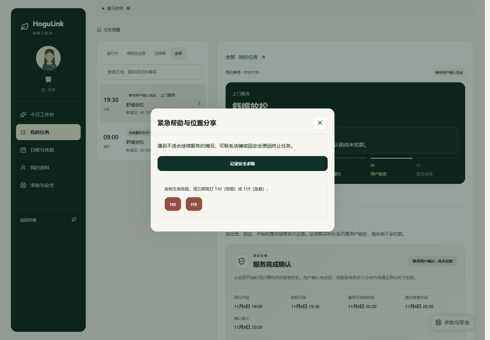

# 技师端业务修复记录

日期：2026-11-06（日本时间）。结论：同日[技师专项复查](QA_STAFF_BUSINESS_AUDIT_2026-11-06.md)发现的三类问题已修复，并通过自动回归与 PC/H5 实际操作验证。代码尚未提交或推送。

## 修复内容

| 问题                       | 现在的行为                                                                                                                                                               | 主要实现                                                         |
| -------------------------- | ------------------------------------------------------------------------------------------------------------------------------------------------------------------------ | ---------------------------------------------------------------- |
| 安全终止越过任务与验收权限 | 仅本人已经确认、仍处于已确认／在途／已到达／服务中、没有结束事实且不在等待改派同意的任务可终止。未回应、已拒绝、已撤回、待验收和已结束任务均被后端拒绝，页面同步隐藏入口 | 共享 `canTerminateStaffTask`；`engine.ts`、`staff-workspace.tsx` |
| 技师订单暴露退款和商户财务 | 技师 HTTP 订单采用字段白名单，列表、详情、写操作结果和嵌套订单统一过滤；不返回已扣款、已退款、平台费、计费费率、顾客账号与支付内部标识。保留原报价、履约和必要支付状态   | `staff-response.ts`、`controller.ts`                             |
| 设备时钟影响动作和倒计时   | 工作台读取 `serverNow`，以服务端时间加单调递增时钟计时；出发窗口、回应截止、日期、待机和请假校验共用该时间。技师爽约面板使用工作台时间，完成面板也改用单调时钟           | `staff.ts`、`server-clock.ts`、工作台／完成／爽约组件            |

SOS 求助与安全终止保持独立：等待验收或已经拒单时，仍可按现有读取权限上报安全事实；不能因此取消整单。正常现场紧急终止仍可执行。财务过滤只作用于技师响应，不删除数据库账务，也不改变顾客、店铺的财务视图或收费规则。

## 回归结果

| 检查                           | 结果                                                               |
| ------------------------------ | ------------------------------------------------------------------ |
| 新增异常用例的修复前验证       | 待验收、未回应、已拒绝、已撤回四种非法终止均先复现失败             |
| 定向后端测试                   | 19 / 19 通过，包括拒绝后的订单／支付／占用不变、SOS 和正常安全终止 |
| 定向前端模型测试               | 6 / 6 通过，包括合法状态矩阵及慢两分钟的设备时间不影响出发窗口     |
| 全量后端测试                   | 814 / 814 通过                                                     |
| 全量前端模型测试               | 184 / 184 通过                                                     |
| 演示素材检查                   | 5 / 5 通过                                                         |
| 业务流程回归                   | 20 组、2,125 项 HTTP / SSR 检查通过；其中技师工作台 122 项         |
| 全工作区类型检查与最终生产构建 | 通过                                                               |

旧回归脚本有几处通过技师接口读取扣款金额；现改为验证技师响应不包含该字段，并由顾客或店铺接口核实实际金额。没有以默认值或删除资金断言掩盖失败。

## 浏览器及接口交叉验证

在独立内存 API `127.0.0.1:4124`、独立网页 `qa.localhost:3124` 实测，所有姓名、地址和订单均为虚构数据：

1. PC 1440 × 1000：待顾客验收任务的详情和浮动安全菜单均保留“记录安全求助”，不显示“因安全原因终止”。直接请求终止返回 `409 INVALID_STATE`，订单与授权不变。
2. H5 390 × 844：已经拒绝的任务不出现终止按钮；接口同样拒绝终止，SOS 可以保存。
3. 等待验收单由顾客确认后完成，扣款 ¥8,700；店铺退款 ¥500。顾客与店铺核对金额正确，技师响应没有财务字段，原报价总额仍可读。
4. 测试服务端比设备时间快约 17 小时：工作台正确显示 11 月 7 日和距预约 90 分钟，页面实际完成“记录出发 → 记录到达 → 开始服务”。没有改电脑系统时间。
5. H5 在服务中实际执行安全终止成功，订单为 `CANCELLED / VOIDED`、扣款为 0，结束后的详细地址隐藏。

其他截图和无凭据的接口结果见 [证据目录](qa-assets/staff-fix-20261106/verification.json)。自动日志保存在同目录；测试临时脚本及启动配置留在本地忽略目录 `.qa/staff-fix-20261106/`，未纳入交付。

验证使用模拟支付与本地安全记录，没有真实扣退款或发送外部通知。此前未提交的个人中心、PC 样式、弹窗和店铺界面改动均保留；原站 `3000/4000` 未被用于写入这些测试订单。正式支付、通知和生产环境验收仍需单独完成。
